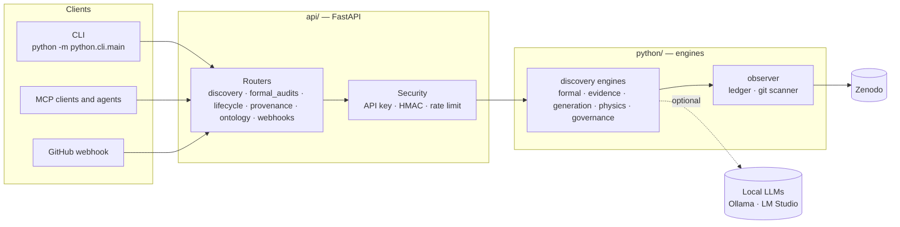

# CoResearcher

[](https://github.com/Fundacion-de-Neurociencias/coresearcher/actions/workflows/ci.yml)
[](LICENSE)
[](pyproject.toml)
[](schemas/openapi.json)

**An auditable engine that tests scientific claims against explicit constraints, falsification rules and evidence provenance.**

CoResearcher audits; it does not answer. Given a claim, it returns a verdict, the rule that produced
it, the evidence it used, and a cryptographic hash that lets anyone reproduce the verdict.

---

## Highlights

- **Formal hypotheses.** Exact evaluation over a finite state space: vacuous, unfalsifiable or self-contradictory hypotheses, conflicting assumptions, counterexamples and logical relations between rivals ([ADR-059](docs/decisions/ADR-DISCOVERY-059-FORMAL-HYPOTHESIS-OBJECT.md)).
- **Auditable formal verdicts.** Every formal report records the engine, z3 version, thresholds and input/output digests, carries mandatory caveats, and names its non-verdicts (UNDECIDED, BLOCKED, ...); `coresearcher formal run` / `analyze` recompute a stored verdict offline and refuse to overwrite a differing one ([ADR-068](docs/decisions/ADR-DISCOVERY-068-AUDITABLE-FORMAL-VERDICTS.md)).
- **Formal verifier for OASE.** `integrations/oase` installs `oase formal run` / `analyze` into Google's Open Agentic Science Engine, so its hypex hypotheses and Stage 1 gates get exact vacuity, contradiction, falsifiability and rival checks with OASE's own provenance, thresholds and relays ([ADR-069](docs/decisions/ADR-DISCOVERY-069-OASE-FORMAL-ADAPTER.md)).
- **Stage gates.** Research projects pass checklist gates from question to report; an agent cannot certify its own work, versions are hash-chained, and releases list every criterion not met ([ADR-063](docs/decisions/ADR-DISCOVERY-063-RESEARCH-LIFECYCLE-STAGE-GATES.md)).
- **Evidence for EdiTXT.** An EvidenceRequest about a lifecycle project, research package, registered claim, formal hypothesis or formal case returns a content-addressed EvidenceGraph with every gap listed; a capability catalogue describes every endpoint ([ADR-067](docs/decisions/ADR-DISCOVERY-067-EVIDENCE-CONTRACT-FOR-EDITXT.md)).
- **Research packages.** One `.crpkg` file carries a project's history and artifacts to another machine, verified on import and read-only until forked ([ADR-065](docs/decisions/ADR-DISCOVERY-065-RESEARCH-PACKAGES.md)).
- **Claim verification.** Reality Contact Score (RCS), Popperian falsification and conservation-law checks.
- **Formal gates.** Exact symbolic verification (SymPy), Lean 4 proof gate, categorical holonomy checks.
- **Provenance.** Append-only scientific ledger, Git-based lineage, Merkle-style hashes, Zenodo export.
- **Sovereign by default.** Runs on local hardware. Local LLMs (Ollama, LM Studio) are optional; without them the system falls back to deterministic symbolic engines.
- **Documented contract.** About 115 REST operations, described by an OpenAPI schema that CI keeps in sync.

**What it is not:** a bibliographic search engine, a generative text system, or a source of
ground-truth conclusions. Every verdict is only as strong as the evidence and benchmarks behind it.

## Status

| Check | Result | Details |
| --- | --- | --- |
| Test suite | 210 passing | [`tests/`](tests) |
| Scientific benchmarks | All 16 scripts run; 1 benchmark withdrawn, 1 scripted demo, see caveats | [Claims register](docs/reference/CLAIMS_REGISTER.md), [confidence intervals](docs/reference/CONFIDENCE_INTERVALS.md) |
| Module maturity | 19 integrated, 40 tested, 17 exercised, 20 prototypes (of 96) | [Module maturity](docs/reference/MODULE_MATURITY.md) |
| Lint, format, language policy | Enforced in CI | [`ci.yml`](.github/workflows/ci.yml) |

Claims are listed with their supporting script, data origin and last result in the
[claims register](docs/reference/CLAIMS_REGISTER.md). Read it before citing any number.

## Architecture



The full specification is in [docs/architecture/ARCHITECTURE.md](docs/architecture/ARCHITECTURE.md).

## Quick start

**Requirements:** Python 3.11 or newer. Git on `PATH` for ledger features. A local OpenAI-compatible model
server (Ollama or LM Studio) only for the formalizer.

```bash
pip install -r requirements-dev.txt
python -m pytest tests -q
```

Run the API. Write endpoints need a key; without one they refuse every request.

```bash
export CORESEARCHER_API_KEY="$(openssl rand -hex 32)"
uvicorn api.server:app --host 127.0.0.1 --port 8001
```

Open <http://127.0.0.1:8001/docs> for interactive documentation. Port 8001 is the ecosystem convention: DataAILab runs
on 8000 and reaches CoResearcher through `CORESEARCHER_URL=http://127.0.0.1:8001`.

Run the CLI:

```bash
python -m python.cli.main info
python -m python.cli.main verify --claim "H0 = 67.4 km/s/Mpc" --rcs 2 --anchors "Planck 2018 Legacy"
```

## Configuration and security

Copy [`.env.example`](.env.example) to `.env` and set the values you need.

| Variable | Purpose |
| --- | --- |
| `CORESEARCHER_API_KEY` | Required in `X-API-Key` for `POST`, `PUT` and `DELETE`. Unset means writes are refused. |
| `CORESEARCHER_GITHUB_WEBHOOK_SECRET` | Verifies `X-Hub-Signature-256` on the GitHub webhook. Unset disables the webhook. |
| `CORESEARCHER_CORS_ORIGINS` | Comma-separated browser origins allowed by CORS. |
| `CORESEARCHER_RATE_LIMIT_PER_MINUTE` | Requests per client IP per minute (default 120). |
| `CORESEARCHER_LIFECYCLE_LOG` | JSON Lines event log of the research lifecycle. Unset keeps lifecycle state in memory. |

The server binds to `127.0.0.1` by default. If you expose it beyond localhost, put it behind a reverse
proxy with TLS. This repository does not configure that.

Details: [`api/security.py`](api/security.py) and the [REST API reference](docs/reference/API.md).

## Documentation

| Topic | Where to start |
| --- | --- |
| Documentation index | [docs/INDEX.md](docs/INDEX.md) |
| Architecture | [docs/architecture/](docs/architecture) |
| REST API (generated) | [docs/reference/API.md](docs/reference/API.md) |
| Claims and evidence | [docs/reference/CLAIMS_REGISTER.md](docs/reference/CLAIMS_REGISTER.md) |
| Architecture decisions (ADRs) | [docs/decisions/](docs/decisions) |
| Governance and policies | [docs/governance/](docs/governance) |
| Public overview | [docs/public/README.md](docs/public/README.md) |

## Repository layout

| Path | Contents |
| --- | --- |
| `api/` | FastAPI application, routers, security and shared state |
| `python/` | Core engines: discovery (formal hypotheses, SMT, formalizer), ledger, ontology plans, CLI |
| `archive/phase1/` | Earlier project layers kept for history, not maintained: observer, knowledge, agents, connectors, workflows, and the TypeScript workspace |
| `schemas/` | JSON and YAML contracts, including `openapi.json` |
| `scripts/` | Benchmark suites, checks and generators |
| `tests/` | Pytest suite |
| `docs/` | Documentation (see [docs/INDEX.md](docs/INDEX.md)) |

## Development

```bash
ruff check tests/ api/
black --check tests/ api/
python scripts/enforce_english_policy.py
python scripts/check_repo_consistency.py
python scripts/export_openapi.py --check
python scripts/generate_api_reference.py --check
```

CI runs these checks on every push and pull request. Code, comments and documentation are in
English ([language policy](docs/governance/LANGUAGE_POLICY.md)).

## Limitations

- Benchmarks are run manually, not in CI. Several use synthetic or hand-built cases, by design.
- One benchmark needs a clinical dataset that is not in this repository, so it cannot be reproduced from a clean clone.
- No claim has yet been validated against an external public dataset with confidence intervals.
- Known open issues are listed in the claims register.

## Ecosystem

CoResearcher works with sibling projects: **DataAILab** (empirical solver and GPU worker) and
**EdiTXT** (editorial and peer-review tooling). See [docs/architecture/ECOSYSTEM_BOUNDARIES.md](docs/architecture/ECOSYSTEM_BOUNDARIES.md).
CoResearcher has no user interface of its own: EdiTXT is the shared frontend, and it reaches CoResearcher through
the evidence contract and the capability catalogue of [ADR-067](docs/decisions/ADR-DISCOVERY-067-EVIDENCE-CONTRACT-FOR-EDITXT.md).

## License

MIT. See [`pyproject.toml`](pyproject.toml). Please cite the project through its Zenodo record once it is published.
