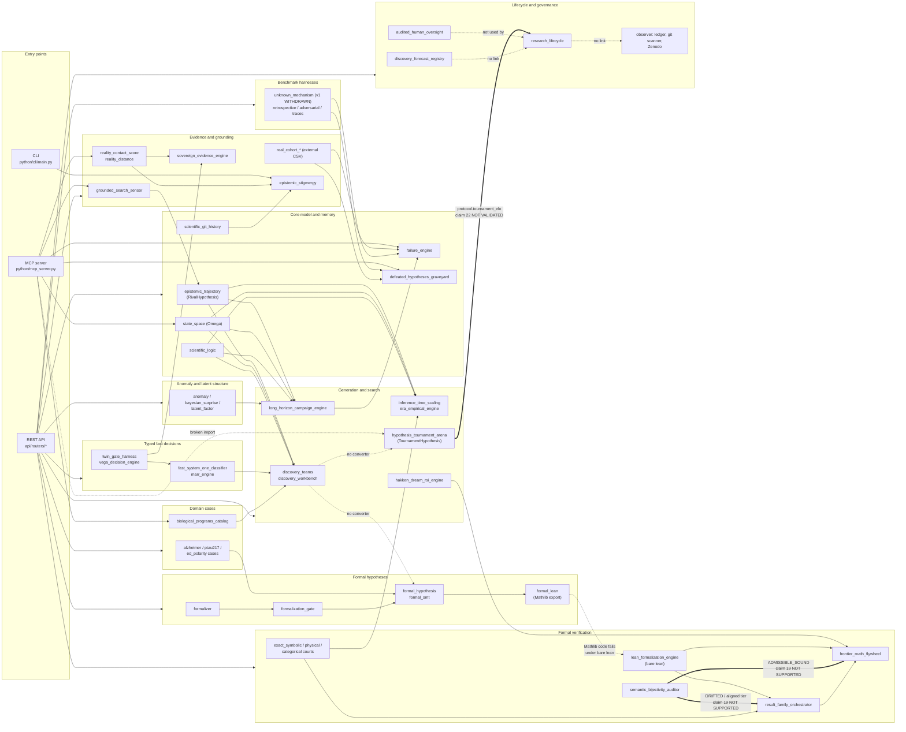

# Capability map

This document maps every module in `python/discovery/`, the REST API (`api/`), the MCP server
(`python/mcp_server.py`), the observer (`python/observer/`) and the knowledge module (`python/knowledge/`)
onto the capabilities they provide, and shows how those capabilities feed each other. It records what the code
does on 2026-10-17. It is not a description of what the modules are meant to do. Where the two differ, this
document follows the code. The [functional review](FUNCTIONAL_REVIEW.md) goes one level deeper: what each
module actually computes, which use case it serves, and whether to keep, wire, merge or archive it.

> **Base commit.** Written against commit `1155240`. Six modules added afterwards are not covered yet: `evidence_service`, `formal_pipeline`, `formal_provenance`, `formal_status`, `formal_thresholds` and `research_package`. Later changes to `formal_hypothesis`, `formalization_gate` and `research_lifecycle` (ADR-065 to ADR-068) may resolve some findings for those modules. Check them against the current code before acting.

Use it to answer three questions before you wire a new feature in:

1. Which module already does this, and does anything call it?
2. Which claim in the [claims register](../reference/CLAIMS_REGISTER.md) backs the verdict it returns?
3. Which other capability consumes its output?

## How this map was built

- **What it does**: the module docstring, checked against the main class and the route that calls it.
- **ADR**: the ADR identifiers cited in the module source. `D-` is `ADR-DISCOVERY-`, `E-` is `ADR-EPISTEMIC-`,
  `S-` is `ADR-SOVEREIGNTY-`, `R-` is `ADR-REASONING-`, `M-` is `ADR-MECH-`. ADR records are in
  [decisions/](../decisions/).
- **Maturity**: the level in [MODULE_MATURITY.md](../reference/MODULE_MATURITY.md), copied unchanged.
- **Reach**: parsed from the code (Python AST). A module is reachable when an API route or MCP tool uses one of its
  names, directly or through the re-exports in `python/discovery/__init__.py`, or when a reachable module imports it.
  "Indirect" means only through another module or the shared state in `api/state.py`.
- **Claim**: the row in the claims register whose script or test imports the module (or calls its route), and
  that row's status. "none" means no row measures the module. Unit tests check behaviour, not scientific
  validity, so a module covered only by unit tests is listed as "none".
- **Calls / Called by**: imports between `python/discovery/` modules, parsed from the source. An import is not
  always a call. The [functional review](FUNCTIONAL_REVIEW.md#4-what-the-counts-say) lists the edges that are
  imports with no call, for example `failure_engine` and the graveyard in the benchmarks and campaigns.

> **The maturity table understates API reach.** `scripts/generate_module_maturity.py` marks a module as used by
> the API only when its *module name* appears under `api/`. Most routers import classes through the package
> re-exports (`from python.discovery import ConstraintCourt`), so the generator misses them. By the AST count,
> 72 of the 78 modules are reachable from the API or the MCP server. 57 of those 72 are not labelled Integrated, and
> 17 are labelled Prototype; 16 of those have a route or MCP tool of their own. A module labelled Prototype here can
> therefore be an **untested public endpoint**, which is worse than unused code. See fix F2.

## Capabilities at a glance

| Capability | Modules | Main entry points | Strongest backing claim |
| --- | --- | --- | --- |
| [Formal hypotheses](#formal-hypotheses) | 5 | `POST /api/hypotheses/{evaluate,compare,entails,formalize}` | 21, 23 PASS (exact by construction); 24 NOT MET, 27 PARTIAL for prose-to-formal |
| [Formal verification](#formal-verification) | 10 | `/api/discovery/lean/*`, `/families/audit`, `/math-flywheel/*`, courts | 1, 4 PASS on constructed cases; 19 NOT SUPPORTED, 20 NOT VALIDATED |
| [Generation and search](#generation-and-search) | 16 | `/api/discovery/tournament/*`, `/campaign/run`, `/workbench/launch`, `/era/*` | 22 NOT VALIDATED; the rest unmeasured |
| [Anomaly and latent structure](#anomaly-and-latent-structure) | 10 | `/anomalies/*`, `/bayesian-surprise/*`, `/universal/*`, `/world-model/*` | 9 PASS (exit code only) |
| [Evidence and grounding](#evidence-and-grounding) | 9 | `/reality-contact/*`, `/evidence/audit`, `/search/grounded-ingest`, MCP RCS tool | 10, 15 PASS on constructed or synthetic data; 3 shows 0.0% gain; 16 PARTIAL |
| [Typed fast decisions](#typed-fast-decisions) | 4 | `/system-one/*`, `/vega/*`, `/harness/*` | 12, 13 PASS on synthetic data |
| [Core model and memory](#core-model-and-memory) | 7 | `api/state.py`, `/graveyard/list`, MCP state and graveyard tools | 11 PASS (exit code only) |
| [Lifecycle and governance](#lifecycle-and-governance) | 5 + observer | `/api/lifecycle/*`, `/oversight/audit`, `/forecasts/*`, PR webhook | 26 PASS (rules only); 2 PASS (exit code only) |
| [Domain cases](#domain-cases) | 7 | `/api/hypotheses/scenarios/alzheimer`, `/biomacromolecular/*`, `/membrane/*` | 25 DRAFT; 14 PASS (simulation contracts) |
| [Benchmark harnesses](#benchmark-harnesses) | 5 | `/unknown-mechanism/*`, `/retrospective/*`, `/adversarial/*`, `/traces/*` | 7 WITHDRAWN, 18 MIXED, 6 and 8 PASS |

No capability is backed by a claim validated against external data with confidence intervals. The register says so
under "Known gaps". Every PASS above is on constructed or synthetic inputs, and several are exit codes only.

## Data flow between capabilities

Solid arrows are imports that exist in the code; some are never called (see the functional review). Thick arrows carry a verdict that rests on a claim that is
NOT SUPPORTED or NOT VALIDATED; the label names the claim. Dotted arrows mark a link that is missing or broken. The two hypothesis representations (the rival hypotheses in `epistemic_trajectory` and
`FormalHypothesis`) never meet in code. That is the largest gap in the map.

## Module inventory

Each table lists one capability. The columns are explained in [How this map was built](#how-this-map-was-built).

### Formal hypotheses

| Module | What it does | ADR | Maturity | Reach (API/MCP) | Claim (status) | Calls | Called by |
| --- | --- | --- | --- | --- | --- | --- | --- |
| `formal_hypothesis` | Formal hypothesis over a declared state space: exact content, conflict, counterexample, comparison and entailment verdicts by enumeration or SMT. | D-006, D-059, D-060 | Integrated | API: 4 routes, e.g. `POST /api/hypotheses/compare` | 21 PASS | `formal_smt` | `alzheimer_formal_scenario`, `ed_polarity_case`, `formal_lean`, `formal_smt`, `formalization_gate`, `formalizer`, `ptau217_cutoff_case` |
| `formal_smt` | z3 back end for formal hypotheses with continuous variables and consequence checking. | D-060 | Tested | indirect, via `formal_hypothesis` | 23 PASS | `formal_hypothesis` | `formal_hypothesis` |
| `formal_lean` | Exports z3-checked consequences of formal hypotheses as Lean 4 theorems. | D-060 | Integrated | API: `POST /api/hypotheses/entails` | 23 PASS | `formal_hypothesis` | - |
| `formalizer` | Local LLM drafts a formal hypothesis from prose (OpenAI-compatible client); the output is a draft for the researcher. | D-002, D-059, D-061, D-064 | Integrated | API: `POST /api/hypotheses/formalize` | 24 **NOT MET** | `formal_hypothesis` | `formalization_gate` |
| `formalization_gate` | Self-consistency gate: N formalizer samples must agree exactly (z3 or enumeration) before a formalization reaches the court. | D-061, D-064 | Integrated | API: `POST /api/hypotheses/formalize` | 27 **PARTIAL** | `formal_hypothesis`, `formalizer` | - |

### Formal verification

| Module | What it does | ADR | Maturity | Reach (API/MCP) | Claim (status) | Calls | Called by |
| --- | --- | --- | --- | --- | --- | --- | --- |
| `lean_formalization_engine` | Scans Lean source for `sorry` and `axiom`, and runs the bare `lean` binary when it is on PATH. | D-047 | Tested | API: `POST /api/discovery/lean/audit` | none | - | `frontier_math_flywheel`, `result_family_orchestrator` |
| `semantic_bijectivity_auditor` | Regex extraction of quantifiers, operators and variables from prose and Lean; calls the pair bijective when they match. | D-048 | Tested | API: `POST /api/discovery/lean/audit-bijectivity` | 19 **NOT SUPPORTED** | - | `frontier_math_flywheel`, `result_family_orchestrator` |
| `result_family_orchestrator` | Builds result families (theorem, lemma, corollary), tiers each node by CAS, Lean and the bijectivity gate, and checks categorical commutativity. | D-043, D-048 | Tested | API: `POST /api/discovery/families/audit` | 19 via the gate (**NOT SUPPORTED**) | `categorical_epistemic_engine`, `exact_symbolic_court`, `lean_formalization_engine`, `semantic_bijectivity_auditor` | `frontier_math_flywheel` |
| `frontier_math_flywheel` | Ingests frontier math tasks, grades submissions with static checks and heuristic rewards, and marks tasks ADMISSIBLE_SOUND through the bijectivity gate. | D-055 | Integrated | API: 2 routes, e.g. `POST /api/discovery/math-flywheel/audit-admissibility` | 19 via the gate; 20 **NOT VALIDATED** | `algebraic_structure_compiler`, `hakken_dream_rsi_engine`, `lean_formalization_engine`, `result_family_orchestrator`, `semantic_bijectivity_auditor` | - |
| `algebraic_structure_compiler` | Compiles algebraic structures and method families for the mathematical flywheel. | D-046 | Tested | API: `POST /api/discovery/flywheel/cycle` | none | - | `frontier_math_flywheel` |
| `exact_symbolic_court` | Exact symbolic (CAS) dual verification of lemma DAGs with obstacle analysis. | E-034 | Tested | API: `POST /api/discovery/exact-symbolic/audit` | none | - | `cogentic_proof_orchestrator`, `result_family_orchestrator` |
| `cogentic_proof_orchestrator` | Parallel prove-verify harness that orchestrates lemma attempts and checks them with the symbolic court. | D-050 | Tested | API: `POST /api/discovery/cogentic/run-proof-discovery` | none | `exact_symbolic_court`, `scientific_logic` | - |
| `categorical_epistemic_engine` | Categories of observations and theories; commutative-diagram audit with a holonomy defect. | none | Exercised | API: `POST /api/discovery/categorical/audit-diagram` | 1 PASS | - | `autopoietic_closure_auditor`, `result_family_orchestrator` |
| `asymptotic_barrier_auditor` | Flags proof strategies that hit known asymptotic or parity barriers. | D-045 | Tested | API: `POST /api/discovery/barriers/audit` | none | - | - |
| `physical_theorem_court` | Audits physical claims and proof DAGs for conservation laws, dimensional coherence and singularities. | E-032 | Integrated | API: `POST /api/discovery/physical-court/audit-theorem` | 4 PASS; 20 NOT VALIDATED (RMSD constant) | - | `inference_time_scaling` |

### Generation and search

| Module | What it does | ADR | Maturity | Reach (API/MCP) | Claim (status) | Calls | Called by |
| --- | --- | --- | --- | --- | --- | --- | --- |
| `hypothesis_tournament_arena` | Pairwise debate and Elo ranking of hypotheses from four caller-supplied axis scores. | D-058 | Integrated | API: 2 routes, e.g. `POST /api/discovery/tournament/debate-match`; MCP: `debate_pairwise_hypotheses` (broken import) | 22 **NOT VALIDATED** | - | - |
| `discovery_teams` | Constraint-led multi-agent discovery campaign over the state space with rival hypotheses and Marr checks. | D-007 | Exercised | API: `POST /api/discovery/campaign/run` | 12 PASS (used by the suite) | `biological_programs_catalog`, `epistemic_trajectory`, `marr_engine`, `scientific_logic`, `state_space` | `discovery_workbench` |
| `discovery_workbench` | One circuit that chains discovery teams, tree search, lab-in-the-loop grounding and logic. | D-009 | Prototype | API: `POST /api/discovery/workbench/launch` | none | `biological_programs_catalog`, `discovery_teams`, `epistemic_trajectory`, `inference_time_scaling`, `lab_in_the_loop_adapter`, `scientific_logic`, `state_space` | - |
| `inference_time_scaling` | Epistemic tree search over reasoning paths, scored by discovery value and the physical court. | D-008, R-031 | Tested | API: `POST /api/discovery/inference-scaling/search` | none | `epistemic_trajectory`, `physical_theorem_court`, `scientific_logic`, `state_space` | `discovery_workbench` |
| `era_empirical_engine` | ERA-style code mutation and closed-loop tree search over empirical analysis variants. | D-057 | Tested | API: 2 routes, e.g. `POST /api/discovery/era/mutate-code` | none | - | - |
| `hakken_dream_rsi_engine` | Literature-link abduction (Hakken) and offline replay of search policies (Dream-RSI). | D-054 | Integrated | API: 2 routes, e.g. `POST /api/discovery/dream-rsi/replay-policy` | none | - | `frontier_math_flywheel` |
| `constraint_discovery_engine` | Mines candidate invariant constraints from multi-cohort data and checks them across cohorts. | none | Prototype | API: `POST /api/discovery/constraints/mine-and-verify` | none | `epistemic_trajectory`, `state_space` | `grounded_search_sensor` |
| `constraint_court` | Adversarial adjudication between incompatible scientific constraints. | none | Prototype | API: `POST /api/discovery/court/adjudicate` | none | - | - |
| `trajectory_evolution` | Scripted multi-iteration theory evolution (H0 fails, H1 fails, and so on) over the state space. | none | Prototype | API: `GET /api/discovery/trajectory-evolution` | none | `scientific_logic`, `state_space` | - |
| `long_horizon_campaign_engine` | Multi-cycle campaign loop: propose, test, diagnose failure, budget, repeat. | none | Exercised | API: `POST /api/discovery/campaigns/long-horizon-run` | none | `anomaly_discovery_engine`, `bayesian_surprise_engine`, `epistemic_trajectory`, `failure_engine`, `latent_factor_discovery`, `reality_distance`, `research_budget_engine`, `scientific_logic`, `state_space` | - |
| `backward_execution_synthesizer` | ToolGrad-style backward synthesis of analysis contracts from executed ground truth. | none | Exercised | API: `POST /api/discovery/contracts/synthesize-backward` | 5 PASS (4/4, 2/5) | - | - |
| `ablation_rebuttal_engine` | Theoretical ablation and simulated reviewer rebuttal over a Lagrangian score. | D-037 | Integrated | API: `POST /api/discovery/ablation-rebuttal/run` | none | `lagrangian_epistemic_engine` | - |
| `lagrangian_epistemic_engine` | Scores theories with a stationary-action epistemic Lagrangian. | D-036 | Integrated | API: `POST /api/discovery/lagrangian/audit` | none | - | `ablation_rebuttal_engine` |
| `limitation_resolution_engine` | Extracts limitations from a result and proposes refinements. | D-042 | Tested | API: `POST /api/discovery/limitations/extract` | none | - | - |
| `socratic_question_auditor` | Audits research questions for answerability and inquiry quality. | D-056 | Tested | none | none | - | - |
| `research_budget_engine` | Tracks compute, cohort and time budgets for campaigns. | none | Prototype | indirect, via `long_horizon_campaign_engine` | none | - | `long_horizon_campaign_engine` |

### Anomaly and latent structure

| Module | What it does | ADR | Maturity | Reach (API/MCP) | Claim (status) | Calls | Called by |
| --- | --- | --- | --- | --- | --- | --- | --- |
| `anomaly_discovery_engine` | Residual-based anomaly detection and clustering across cohorts. | none | Prototype | API: `POST /api/discovery/anomalies/detect-and-cluster` | 16 **PARTIAL** (used by the suite) | - | `long_horizon_campaign_engine`, `real_cohort_campaign_runner` |
| `bayesian_surprise_engine` | KL-divergence surprise and information gain between prior and posterior. | none | Exercised | API: `POST /api/discovery/bayesian-surprise/evaluate` | none | - | `adversarial_destruction_test`, `long_horizon_campaign_engine`, `retrospective_time_split_benchmark`, `traces_epistemic_adapter` |
| `latent_factor_discovery` | Unsupervised extraction of latent factors from high-dimensional matrices. | none | Exercised | indirect, via `long_horizon_campaign_engine` | none | - | `long_horizon_campaign_engine` |
| `novelty_detector` | Flags anomalies relative to the structure of known knowledge. | none | Prototype | none | none | - | - |
| `manifold_detector` | Detects hypotheses that try to open a new scientific manifold. | none | Prototype | none | none | - | - |
| `test_manifold_detector` | A test script for `manifold_detector` that sits inside the library package. | none | Prototype | none | none | - | - |
| `universal_discovery_engine` | Cross-domain latent invariant discovery over four domains; one domain reads an external cohort file. | none | Exercised | API: `POST /api/discovery/universal/cross-domain-benchmark` | 9 PASS (exit code only) | - | - |
| `multiscale_abstraction_engine` | Multiscale latent abstraction and prediction across levels. | D-039 | Tested | API: `POST /api/discovery/multiscale/predict` | none | - | - |
| `world_model_adapter` | Adapter to an external World Model (H-JEPA) repository for latent simulation guardrails. | D-038 | Integrated | API: `POST /api/discovery/world-model/simulate` | none | - | `biomacromolecular_auditor` |
| `energy_predictive_auditor` | Non-generative energy-based auditor with a VICReg regularizer and model-predictive planning. | E-040 | Tested | API: `POST /api/discovery/energy-ebm/audit` | none | - | - |

### Evidence and grounding

| Module | What it does | ADR | Maturity | Reach (API/MCP) | Claim (status) | Calls | Called by |
| --- | --- | --- | --- | --- | --- | --- | --- |
| `grounded_search_sensor` | Extracts structured source records (DOI, PMID, effect sizes) with hash lineage; Paper2Agent queries. | none | Exercised | API: 3 routes, e.g. `POST /api/discovery/paper-agent/execute`; MCP: `query_paper2agent_reproducible_tools` | 10 PASS | `constraint_discovery_engine`, `epistemic_trajectory` | - |
| `reality_contact_score` | Reality Contact Score (levels 0 to 4) from an evidence chain. | none | Tested | API: `POST /api/discovery/reality-contact/evaluate`; MCP: `calculate_reality_contact_score` | 10 PASS; 15 PASS (via stigmergy) | - | `epistemic_stigmergy`, `sovereign_evidence_engine`, `traces_epistemic_adapter` |
| `reality_distance` | Substrate distance (dry, damp, wet) for hypotheses and constraints. | none | Prototype | API: `POST /api/discovery/reality-distance/evaluate`; MCP: `calculate_reality_contact_score` | none | - | `long_horizon_campaign_engine`, `traces_epistemic_adapter` |
| `sovereign_evidence_engine` | Weights evidence by study design and polarity, and audits a claim adversarially. | D-044 | Tested | API: `POST /api/discovery/evidence/audit` | none | `reality_contact_score`, `twin_gate_harness` | - |
| `epistemic_stigmergy` | Pheromone field over claims, an instrument compiler and an RCS reality firewall. | D-027 | Tested | API: 3 routes, e.g. `POST /api/discovery/stigmergy/audit-reality-firewall` | 15 PASS | `constraint_box`, `reality_contact_score`, `scientific_git_history` | - |
| `lab_in_the_loop_adapter` | Maps a hypothesis to a lab recipe and a simulated instrument readout. | D-008 | Prototype | API: `POST /api/discovery/lab-in-the-loop/ground-recipe` | none | - | `discovery_workbench` |
| `real_cohort_empirical_pipeline` | Runs discovery on a MetaboAD CSV at a hard-coded path outside the repository. | none | Prototype | API: `POST /api/discovery/real-cohort/run-empirical-discovery` | 3 PASS on external data, 0.0% error reduction | - | - |
| `real_cohort_campaign_runner` | Multi-biomarker campaign suite with graveyard and autopsy. | none | Exercised | API: `POST /api/discovery/campaigns/run-heterogeneous-suite` | 16 **PARTIAL** | `anomaly_discovery_engine`, `defeated_hypotheses_graveyard`, `failure_engine` | - |
| `reliability_auditor` | Simulated blinded multi-expert review of research outputs. | D-008 | Prototype | API: `POST /api/discovery/reliability/audit` | none | - | - |

### Typed fast decisions

| Module | What it does | ADR | Maturity | Reach (API/MCP) | Claim (status) | Calls | Called by |
| --- | --- | --- | --- | --- | --- | --- | --- |
| `fast_system_one_classifier` | Typed probabilistic triage (Marr level, PR triage) with tier selection. | none | Tested | API: 2 routes, e.g. `POST /api/discovery/system-one/classify-marr` | 12 PASS (after fix); 13 PASS | `epistemic_trajectory`, `twin_gate_harness`, `vega_decision_engine` | `marr_engine` |
| `vega_decision_engine` | Typed decisions as particles settling in an energy landscape. | D-053 | Tested | API: `POST /api/discovery/vega/simulate-decision` | none | - | `fast_system_one_classifier`, `twin_gate_harness` |
| `twin_gate_harness` | Continuous verification harness: invariant runner, Hakken evidence gate, Dream-RSI failure triage. | none | Exercised | API: 4 routes, e.g. `POST /api/discovery/harness/dream-classify-failure` | 13 PASS | `vega_decision_engine` | `fast_system_one_classifier`, `sovereign_evidence_engine` |
| `marr_engine` | Checks alignment across Marr's computational, algorithmic and implementational levels. | none | Prototype | API: `POST /api/discovery/reliability/audit` | none | `epistemic_trajectory`, `fast_system_one_classifier` | `discovery_teams` |

### Core model and memory

| Module | What it does | ADR | Maturity | Reach (API/MCP) | Claim (status) | Calls | Called by |
| --- | --- | --- | --- | --- | --- | --- | --- |
| `state_space` | Explicit state space (Omega) and volume-exclusion arithmetic. | none | Integrated | MCP: `inspect_state_space`; indirect, shared API state | none | - | `constraint_discovery_engine`, `discovery_teams`, `discovery_workbench`, `inference_time_scaling`, `long_horizon_campaign_engine`, `traces_epistemic_adapter`, `trajectory_evolution` |
| `epistemic_trajectory` | Core data model: representations, rivals, implications, explanation levels, discovery value. | D-001, D-006, M-001 | Prototype | API: `POST /api/audit/evidence` | none | - | `biological_programs_catalog`, `constraint_discovery_engine`, `discovery_teams`, `discovery_workbench`, `fast_system_one_classifier`, `grounded_search_sensor`, `inference_time_scaling`, `long_horizon_campaign_engine`, `marr_engine`, `retrospective_time_split_benchmark`, `traces_epistemic_adapter` |
| `scientific_logic` | Modus tollens with auxiliary assumptions (Lakatos protective belt). | none | Prototype | API: `POST /api/audit/evidence` | none | - | `cogentic_proof_orchestrator`, `discovery_teams`, `discovery_workbench`, `inference_time_scaling`, `long_horizon_campaign_engine`, `traces_epistemic_adapter`, `trajectory_evolution` |
| `scientific_git_history` | Version history of theories as commits with epistemic diffs (Agora shared index). | none | Tested | API: 6 routes, e.g. `GET /api/discovery/git/verified-claims` (through shared state) | 11 PASS; 15 PASS | - | `epistemic_stigmergy` |
| `failure_engine` | Duhem-Quine root-cause decomposition of a failed prediction. | none | Exercised | API: `POST /api/discovery/failure/diagnose-root-cause`; MCP: `execute_scientific_failure_autopsy` | 14 PASS (used by the suite) | - | `adversarial_destruction_test`, `long_horizon_campaign_engine`, `membrane_dynamics_auditor`, `real_cohort_campaign_runner`, `retrospective_time_split_benchmark`, `traces_epistemic_adapter` |
| `defeated_hypotheses_graveyard` | Registry of refuted hypotheses with the predictions that refuted them. | none | Prototype | API: `GET /api/discovery/graveyard/list`; MCP: `query_defeated_hypotheses_graveyard` | 16 **PARTIAL** (used by the suite) | - | `adversarial_destruction_test`, `real_cohort_campaign_runner`, `retrospective_time_split_benchmark` |
| `auto_explicability` | Generates prose implication text for API responses. | none | Prototype | API: 6 routes, e.g. `GET /api/discovery/biological-programs` | none | - | - |

### Lifecycle and governance

| Module | What it does | ADR | Maturity | Reach (API/MCP) | Claim (status) | Calls | Called by |
| --- | --- | --- | --- | --- | --- | --- | --- |
| `research_lifecycle` | Stage gates with self, verifier and human checks, a hash-chained log and an artifact watcher. | D-063 | Integrated | API: 10 routes, e.g. `GET /api/lifecycle/ontrack` | 26 PASS (rules only) | - | - |
| `audited_human_oversight` | Detects rubber-stamp human approvals from interaction telemetry. | D-049 | Tested | API: `POST /api/discovery/oversight/audit` | none | - | - |
| `discovery_forecast_registry` | Hash-sealed prospective forecast registration and integrity audit. | none | Exercised | API: 3 routes, e.g. `GET /api/discovery/forecasts/audit-integrity` | none | - | - |
| `sovereign_epistemic_bunker` | Notarizes reasoning records and audits an air-gap perimeter. | S-041 | Tested | API: 2 routes, e.g. `POST /api/discovery/sovereignty/audit-perimeter` | none | - | - |
| `epistemic_pr_auditor` | GitHub PR webhook auditor for leakage, conservation breaches and p-hacking. | E-033 | Integrated | API: `POST /api/discovery/github/audit-pr-webhook` | 2 PASS (exit code only) | - | - |

### Domain cases

| Module | What it does | ADR | Maturity | Reach (API/MCP) | Claim (status) | Calls | Called by |
| --- | --- | --- | --- | --- | --- | --- | --- |
| `alzheimer_formal_scenario` | The Alzheimer demo rivals as formal hypotheses. | D-059, D-061 | Integrated | API: `GET /api/hypotheses/scenarios/alzheimer` | 25 DRAFT | `formal_hypothesis` | - |
| `ptau217_cutoff_case` | Plasma p-tau217 two-cutoff rule as a formal hypothesis. | none | Tested | none | none | `formal_hypothesis` | - |
| `ed_polarity_case` | Error-diffusion polarity claim as a formal hypothesis, proved by z3 and Lean. | D-059 | Tested | none | none | `formal_hypothesis` | - |
| `biological_programs_catalog` | Canonical biological programs (mechanistic units) for the neurodegeneration domain. | none | Prototype | MCP: `list_biological_programs`; indirect, shared API state | none | `epistemic_trajectory` | `discovery_teams`, `discovery_workbench` |
| `biomacromolecular_auditor` | Coordination-geometry and ternary-complex consistency audit. | D-051 | Tested | API: `POST /api/discovery/biomacromolecular/audit-complex` | none | `world_model_adapter` | - |
| `membrane_dynamics_auditor` | Membrane simulation contracts and Duhem-Quine blame attribution. | D-026 | Exercised | API: 3 routes, e.g. `POST /api/discovery/membrane/audit-duhem-quine` | 14 PASS | `failure_engine` | - |
| `autopoietic_closure_auditor` | Rosen (M,R) closure audit over a categorical model. | D-052 | Tested | API: `POST /api/discovery/autopoietic/audit-closure` | none | `categorical_epistemic_engine` | - |

### Benchmark harnesses

| Module | What it does | ADR | Maturity | Reach (API/MCP) | Claim (status) | Calls | Called by |
| --- | --- | --- | --- | --- | --- | --- | --- |
| `unknown_mechanism_benchmark` | Generates blind worlds with hidden laws; v1 100-world benchmark runner. | none | Exercised | API: `POST /api/discovery/unknown-mechanism/run-100-worlds-benchmark` | 7 **WITHDRAWN**; 18 MIXED (v2 reuses its generator) | - | - |
| `constraint_box` | Synthetic worlds with hidden invariant rules (benchmark). | none | Prototype | API: `POST /api/discovery/constraint-box/run-benchmark` | none | - | `epistemic_stigmergy` |
| `retrospective_time_split_benchmark` | Retrospective benchmark with inputs frozen at 2018. | none | Exercised | API: `POST /api/discovery/retrospective/run-time-split-benchmark` | 6 PASS (exit code only) | `bayesian_surprise_engine`, `defeated_hypotheses_graveyard`, `epistemic_trajectory`, `failure_engine` | - |
| `adversarial_destruction_test` | 50-case adversarial trap suite. | none | Exercised | API: `POST /api/discovery/adversarial/run-destruction-test` | 8 PASS (42% buried) | `bayesian_surprise_engine`, `defeated_hypotheses_graveyard`, `failure_engine` | - |
| `traces_epistemic_adapter` | Wraps external benchmark tasks (TRACES, BroadBox) and scores epistemic rigor. | none | Exercised | API: `POST /api/discovery/traces/evaluate-epistemic-rigor` | none | `bayesian_surprise_engine`, `epistemic_trajectory`, `failure_engine`, `reality_contact_score`, `reality_distance`, `scientific_logic`, `state_space` | - |

### Components outside `python/discovery/`

| Component | What it does | Reach | Calls or feeds |
| --- | --- | --- | --- |
| `api/routers/discovery.py` | Generation, evidence, benchmark and campaign routes (`/api/discovery/*`) | API | 31 discovery modules through package re-exports |
| `api/routers/formal_audits.py` | Formal, physical, typed-decision and sovereignty routes | API | 28 discovery modules |
| `api/routers/hypotheses.py` | Formal hypothesis routes: evaluate, compare, entails, formalize, Alzheimer scenario | API | `formal_hypothesis`, `formal_lean`, `formalizer`, `formalization_gate`, `alzheimer_formal_scenario` |
| `api/routers/lifecycle.py` | Research lifecycle routes (`/api/lifecycle/*`) | API | `research_lifecycle` |
| `api/routers/provenance.py` | Evidence audit, observer ledger, Zenodo publish | API | `epistemic_trajectory`, `scientific_logic`, `auto_explicability`, observer |
| `api/routers/ontology.py` | Ontology plan, apply, rollback (ADR-ONTOLOGY-035) | API | `python/knowledge/ontology_plan_engine.py` |
| `api/routers/webhooks.py` | GitHub PR webhook | API | `epistemic_pr_auditor` |
| `api/state.py` | Process-wide in-memory state: Omega, the Git history, the graveyard, rivals, workbenches | API, MCP | `state_space`, `scientific_git_history`, `defeated_hypotheses_graveyard`, `epistemic_trajectory`, `discovery_workbench`, `biological_programs_catalog` |
| `python/mcp_server.py` (not yet committed) | Eight FastMCP tools for Claude clients | MCP | See [finding 1](#1-verdicts-that-rest-on-unsupported-or-unmeasured-claims) for two defective tools |
| `python/observer/scientific_ledger.py`, `git_scanner.py` | Rebuilds a project ledger from Git history | API (`/api/observer/ledger`) | Not fed by `research_lifecycle` or `scientific_git_history` |
| `python/observer/zenodo_publisher.py`, `ledger_normalizer.py` | Publishes a ledger to Zenodo | API (`/api/zenodo/publish`) | Ledger only |
| `python/observer/claude_science_bridge.py` (not yet committed) | Ingests Claude Science artifacts | None | Imports `python.agents.router.agent_router`, whose source was archived by ADR-DISCOVERY-062. The import fails |
| `python/knowledge/ontology_plan_engine.py` | Ontology lifecycle with blast-radius gate | API | None |
| `python/cli/main.py` | `coresearcher verify/serve/test` CLI (cites ADR-QA-002, which has no record) | CLI | `epistemic_stigmergy` |
| `python/agents/`, `python/connectors/` | Only stale `__pycache__` files remain. The source was archived by ADR-DISCOVERY-062 | None | None |

## Findings

### 1. Verdicts that rest on unsupported or unmeasured claims

These modules are reachable from the API or the MCP server and return a verdict, a label or a score that a caller
can read as validated. The claim behind it is NOT SUPPORTED, NOT VALIDATED, WITHDRAWN, or not measured at all.

| # | Where the verdict surfaces | What it asserts | What backs it |
| --- | --- | --- | --- |
| 1.1 | `frontier_math_flywheel.audit_problem_admissibility` via `POST /api/discovery/math-flywheel/audit-admissibility` | `ADMISSIBLE_SOUND`: "statement and formal Lean declaration are bijectively aligned" | Only `semantic_bijectivity_auditor`. [Claim 19](../reference/CLAIMS_REGISTER.md) is **NOT SUPPORTED**: on 19 openai/math results, its score never changed between original and mutated statements (AUROC 0.524, null 0.524). The Lean kernel is not consulted for this verdict. |
| 1.2 | `result_family_orchestrator` via `POST /api/discovery/families/audit` | Node tiers `LEAN_FORMALIZED` and `DUAL_VERIFIED_GROUND_TRUTH` require the bijectivity gate; failing it sets `DRIFTED_FORMALIZATION_MISMATCH` | The same gate (claim 19). Passing the gate is no evidence of fidelity, and failing it is no evidence of drift. |
| 1.3 | `POST /api/discovery/lean/audit-bijectivity` | Exposes the gate on its own as a "claim-to-formal isomorphism" audit | Claim 19, **NOT SUPPORTED**. |
| 1.4 | `frontier_math_flywheel` grading via `POST /api/discovery/math-flywheel/run-cycle` | `partial_proof_progress` 1.0 when the text declares a theorem and has no `sorry` or `axiom`; otherwise 0.20 + 0.15 per bridge lemma; axiom hygiene 0.70 with a `sorry` | [Claim 20](../reference/CLAIMS_REGISTER.md), **NOT VALIDATED**. These are hand-set constants. A score of 1.0 can be returned without running the Lean kernel. |
| 1.5 | `lean_formalization_engine` via `POST /api/discovery/lean/audit`, and through 1.1 and 1.2 | `FULLY_VERIFIED_KERNEL` when bare `lean` exits 0 and the text has no `sorry` | No claim row. User-declared `axiom`s are listed but do not block the verified status. The bare `lean` binary has no Mathlib, so any `import Mathlib` source (including every theorem `formal_lean` exports) fails as `SYNTAX_OR_TYPE_ERROR`. |
| 1.6 | `research_lifecycle` PROTOCOL gate, check `protocol.tournament_elo` (`verify_tournament_elo`, min Elo 1200) | A candidate "defeated rival hypotheses in the Elo arena above threshold" | [Claim 22](../reference/CLAIMS_REGISTER.md), **NOT VALIDATED**: the four axis scores are caller inputs, and a match is their weighted difference. A governance gate therefore passes on numbers the caller chose. |
| 1.7 | `POST /api/discovery/tournament/*` | Elo ranking and debate winner | Claim 22, **NOT VALIDATED**. |
| 1.8 | MCP tools `calculate_reality_contact_score`, `execute_scientific_failure_autopsy`, `query_defeated_hypotheses_graveyard` | Evidence level, failure autopsy, refuted hypotheses | The first two crash with `TypeError` (wrong field names and a missing method; missing required arguments). The RCS tool would also turn every evidence ID into `WET_EMPIRICAL` evidence with `p_value=0.001` and `replicated=True`. The graveyard tool returns nothing whenever a `domain` is given, because records have no domain field. |
| 1.9 | MCP tool `debate_pairwise_hypotheses` | Debate result and updated Elo | Imports `python.discovery.hypothesis_elo_tournament`, which does not exist, so the tool fails at call time. It also hard-codes three of the four axis scores. |
| 1.10 | `POST /api/discovery/unknown-mechanism/run-100-worlds-benchmark` | 100-world v1 benchmark summary | [Claim 7](../reference/CLAIMS_REGISTER.md) is **WITHDRAWN** (test-split selection, true laws in the library, the +33353% figure). The route still runs v1. |
| 1.11 | `POST /api/discovery/real-cohort/run-empirical-discovery`, `POST /api/discovery/campaigns/run-heterogeneous-suite` | Real-cohort discovery outcomes | Claim 3 reports **0.0%** out-of-sample error reduction on data outside the repository (hard-coded path `C:\Users\usuario\...`). Claim 16 is **PARTIAL**: a sub-check fails while the suite prints "FULLY VALIDATED". |
| 1.12 | `POST /api/hypotheses/formalize` | A formal hypothesis drafted from prose | Claim 24 **NOT MET** (equivalence to gold 0.15 to 0.50, below 0.80), claim 27 **PARTIAL**. The route correctly labels the output a draft, and only gate-accepted drafts are evaluated. This is the best-guarded entry in this list. |
| 1.13 | Most other `/api/discovery/*` routes (courts, typed decisions, evidence weighting, anomaly, latent, sovereignty, oversight) | Verdict enums such as `SOUND`, `ADMISSIBLE`, `VERIFIED`, `CERTIFIED` | No claim row. Unit tests check arithmetic and contracts only. Treat every such verdict as unmeasured. |

### 2. Duplicated or overlapping modules that should be merged

| # | Modules | Overlap | Proposed merge |
| --- | --- | --- | --- |
| 2.1 | `epistemic_trajectory.RivalHypothesis`, `hypothesis_tournament_arena.TournamentHypothesis`, `formal_hypothesis.Hypothesis` | Three hypothesis types with no converter between them. Generation (teams, workbench, campaigns) never produces a formal hypothesis, and the tournament never sees one. | Make `formal_hypothesis` the canonical object. Add an optional formal payload to the rival type, and have the tournament take its axis scores from formal verdicts (counterexamples, entailments, comparisons) instead of caller inputs. |
| 2.2 | `lean_formalization_engine` (bare `lean`, regex scan) and `formal_lean` (Mathlib export, `lake env lean`) | Two Lean paths whose outputs are incompatible (finding 1.5) | One Lean runner that uses the Mathlib toolchain and treats `axiom` and `sorry` as failures. The Lean fidelity auditor (`scripts/benchmarks/openai_math_lean_fidelity.py`, on branch `fix/openai-math-mutation-operators`) needs the same runner. |
| 2.3 | `semantic_bijectivity_auditor`, `formalization_gate`, the planned Lean fidelity auditor | Three answers to "does the formal statement say what the prose says?" | Replace the bijectivity gate with the Lean fidelity auditor once a claim supports it, using three outcomes (faithful, flagged, abstain). Keep `formalization_gate` as the self-consistency step in front of it. |
| 2.4 | `hakken_dream_rsi_engine` and `twin_gate_harness` (`HakkenEvidenceGate`, `DreamRSIStrategyGate`, routes `/harness/hakken-evidence-audit` and `/harness/dream-classify-failure`) | Two Hakken and Dream-RSI implementations behind separate routes | Keep one, in `hakken_dream_rsi_engine`, and make the harness call it. |
| 2.5 | `fast_system_one_classifier`, `vega_decision_engine`, `twin_gate_harness.JevContinuousVerifier`, `sovereign_evidence_engine` ("Jev-style auditor"), `energy_predictive_auditor`, `lagrangian_epistemic_engine` | Six typed or energy-based scoring engines with no shared interface and no measured accuracy | One typed-decision interface with a single default back end. Do not add a seventh engine until one of them is measured. |
| 2.6 | `reality_contact_score`, `reality_distance`, `epistemic_stigmergy.RealityContactFirewall`, `sovereign_evidence_engine` | Four ways to score how much reality a claim has touched | One evidence model (study design, substrate, replication) with RCS and substrate tier derived from it. The MCP tool should accept real evidence attributes (finding 1.8). |
| 2.7 | `marr_engine` and `fast_system_one_classifier` (`/system-one/classify-marr`); `reliability_auditor` and `marr_engine` share `/reliability/audit` | Marr classification in two places | Fold `marr_engine` into the classifier or the reverse. |
| 2.8 | `failure_engine`, `scientific_logic`, `membrane_dynamics_auditor` (Duhem-Quine), `ablation_rebuttal_engine` | Several Duhem-Quine blame attributions. The membrane auditor imports only an enum from `failure_engine`, not its logic | Use `scientific_logic` as the single blame step, absorbing `failure_engine`'s categories and the membrane rules (see the functional review). |
| 2.9 | `exact_symbolic_court`, `physical_theorem_court`, `formal_smt`, `categorical_epistemic_engine` | Several "courts" verify lemma DAGs with different back ends (CAS, rules, z3) | Route exact checks through `formal_smt` where the claim fits its fragment. Keep the CAS court for symbolic identities. |
| 2.10 | `scientific_git_history`, the `research_lifecycle` hash-chained log, `discovery_forecast_registry` sealing, `sovereign_epistemic_bunker` notarization, observer `scientific_ledger` | Five provenance and hash-chain records that never reference each other | One provenance log. The lifecycle log is the most rigorous (it replays and has a watcher), so the others should write into it. |
| 2.11 | `discovery_teams`, `discovery_workbench`, `long_horizon_campaign_engine`, `real_cohort_campaign_runner`, `era_empirical_engine`, `inference_time_scaling`, `trajectory_evolution` | Seven campaign or search loops | One campaign loop with pluggable proposers. Each loop should hand its candidates to the formal track (2.1) and the lifecycle. |
| 2.12 | `anomaly_discovery_engine`, `novelty_detector`, `manifold_detector`, `bayesian_surprise_engine` | Four anomaly or novelty detectors; two of them have no caller | Keep `bayesian_surprise_engine` and `anomaly_discovery_engine`. Archive the other two (finding 3). |
| 2.13 | `audited_human_oversight` and the HUMAN checks in `research_lifecycle` | Human sign-off is gated in the lifecycle, but the rubber-stamp detector is not consulted | Have a HUMAN check pass only with an oversight report attached. |

### 3. Prototypes with no caller

No route, MCP tool, other module, test or script reaches these modules:

| Module | Note |
| --- | --- |
| `manifold_detector` | Archive. Overlaps 2.12. |
| `novelty_detector` | Archive. Overlaps 2.12. |
| `test_manifold_detector` | A test file inside the library package. It imports `discovery.manifold_detector`, a path that only resolves with `python/` on `sys.path`. Move it to `tests/` or delete it with the detector. |

Reachable only from tests or scripts, with no production caller:

| Module | Note |
| --- | --- |
| `socratic_question_auditor` (ADR-DISCOVERY-056) | Tested, no route. A natural check for the lifecycle's QUESTION stage. |
| `ed_polarity_case`, `ptau217_cutoff_case` | Showcase cases. This is expected, but the Alzheimer case has a route and these do not. |

Reachable only through one other module:

| Module | Note |
| --- | --- |
| `research_budget_engine`, `latent_factor_discovery` | Used only by `long_horizon_campaign_engine`. |
| `formal_smt` | Used only through `formal_hypothesis`, as intended. |

Code outside `python/discovery/` with no working caller: `python/observer/claude_science_bridge.py` (broken
import), and `python/agents/` and `python/connectors/` (bytecode only).

### Other integrity issues found while mapping

- **Maturity generator undercounts API reach** (see [How this map was built](#how-this-map-was-built)). Sixteen
  modules labelled Prototype have a live, untested route or MCP tool, among them `constraint_court`, `discovery_workbench`,
  `real_cohort_empirical_pipeline`, `reality_distance` and `reliability_auditor`.
- **ADRs cited but not recorded**: `ADR-DISCOVERY-026` (membrane dynamics), `ADR-DISCOVERY-027` (stigmergy) and
  `ADR-QA-002` (CLI) have no file in [decisions/](../decisions/).
- **Hard-coded external paths**: `real_cohort_empirical_pipeline` and `universal_discovery_engine` read
  `C:\Users\usuario\Neurodiagnoses Ecosystem\data\metaboad_atn_processed.csv`, and `world_model_adapter` points at
  `C:\Users\usuario\World Model`. On any other machine these routes fall back or fail.
- **Benchmarks inside the library**: five benchmark harnesses live in `python/discovery/` and are exposed as API
  routes, so a client can run a withdrawn benchmark (1.10) as if it were a feature.

## Prioritized integration fixes

Ordered by how much a wrong verdict could mislead a user, then by effort.

| Priority | Fix | Addresses | Effort |
| --- | --- | --- | --- |
| P0 | **F1.** Label `ADMISSIBLE_SOUND`, the bijectivity route and the result-family Lean tiers as unsupported in API responses (for example `fidelity_evidence: "unsupported (claim 19)"`), or return `NOT_ASSESSED` until a fidelity claim is supported. | 1.1 to 1.3 | Small |
| P0 | **F2.** Fix `generate_module_maturity.py` to resolve package re-exports (AST, as in this map), regenerate the table and README counts, and add a level for "API, untested". | Maturity undercount, 1.13 | Small |
| P0 | **F3.** Repair or remove the defective MCP tools: three crash (`calculate_reality_contact_score`, `debate_pairwise_hypotheses`, `execute_scientific_failure_autopsy`), and the graveyard filter returns nothing. Remove the hard-coded `p_value`, `replicated` and substrate from the RCS tool. Commit `python/mcp_server.py` only after these are fixed. | 1.8, 1.9 | Small |
| P0 | **F4.** Remove or disable the v1 `run-100-worlds-benchmark` route, or make it return the withdrawal notice. | 1.10 | Small |
| P1 | **F5.** One Lean runner on the Mathlib toolchain that fails on `axiom` and `sorry`, used by `lean_formalization_engine`, `formal_lean` checks and the fidelity auditor. | 1.5, 2.2 | Medium |
| P1 | **F6.** Make `protocol.tournament_elo` advisory, not a gate, until claim 22 is validated. Alternatively, feed the arena with formal verdicts instead of caller scores. | 1.6, 2.1 | Small (advisory) or Medium |
| P1 | **F7.** Bridge generation to the formal track: a converter from `RivalHypothesis` to a `formalizer` draft, then `formalization_gate` and `formal_hypothesis`, so campaign output reaches the exact court. | 2.1, 2.11 | Medium |
| P1 | **F8.** Wire the Lean fidelity auditor in place of `semantic_bijectivity_auditor` once its phase 3 supports a claim. Use three outcomes, and never report an abstention as alignment. | 2.3 | Medium, blocked on phase 3 |
| P2 | **F9.** Require an `audited_human_oversight` report for lifecycle HUMAN checks, and use `socratic_question_auditor` at the QUESTION stage. | 2.13, finding 3 | Small |
| P2 | **F10.** Merge the duplicate Hakken and Dream-RSI implementations, and the Marr classifiers. | 2.4, 2.7 | Small |
| P2 | **F11.** Make the lifecycle log the single provenance record, with the forecast registry, Git history and observer ledger writing into it. | 2.10 | Medium |
| P2 | **F12.** Move benchmark harnesses out of `python/discovery/` into `benchmarks/`, and move their routes behind an explicit benchmark prefix. Replace hard-coded `C:\Users\usuario\...` paths with configuration. | Other issues, 1.11 | Medium |
| P3 | **F13.** Archive `manifold_detector`, `novelty_detector` and `test_manifold_detector`; fix or archive `claude_science_bridge`; delete the stale `python/agents` and `python/connectors` bytecode. Record ADR-DISCOVERY-026, ADR-DISCOVERY-027 and ADR-QA-002, or remove the citations. | Finding 3, other issues | Small |
| P3 | **F14.** Pick one typed-decision and one evidence-scoring interface, and measure it before adding engines. | 2.5, 2.6, 2.9 | Large |
