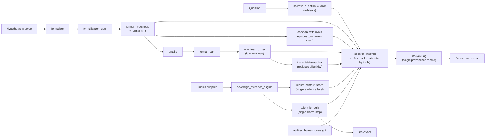

# Functional review

This review complements the [capability map](CAPABILITY_MAP.md). The map records how modules connect. This review
reads the code of every module and records what each one actually does: what it offers, which use case it serves,
whether it must run with other modules, and what to do with it. It was written on 2026-10-17 from the code on
`master`. Where an ADR or docstring says more than the code does, the review follows the code and says so.

> **Base commit.** Written against commit `1155240`. Six modules added afterwards are not covered yet: `evidence_service`, `formal_pipeline`, `formal_provenance`, `formal_status`, `formal_thresholds` and `research_package`. Later changes to `formal_hypothesis`, `formalization_gate` and `research_lifecycle` (ADR-065 to ADR-068) may resolve some findings for those modules. Check them against the current code before acting.

Each module was read in full, with its ADR and the routes that call it. Where a finding was surprising, the
function was run in memory with a small probe input. Nothing in the repository was changed.

## 1. What CoResearcher is for

**CoResearcher is a local, auditable court for scientific claims.** A researcher, a reviewer or an agent brings a
hypothesis, in prose or as explicit constraints, together with the evidence offered for it. CoResearcher returns
verdicts it can justify:

- whether the hypothesis can be falsified at all;
- whether its assumptions conflict;
- which states would refute it;
- how it relates to rival hypotheses;
- what it entails;
- how much evidence supports it, and of what kind.

Each verdict carries the rule that produced it and a hash that lets anyone reproduce it. Around that court,
CoResearcher governs the research project itself:

- stage gates where whoever produced a result cannot certify it;
- a hash-chained record of what was decided;
- a release that says whether the work was pre-registered or exploratory.

It does not generate answers, search the literature or replace experiments.

This statement takes the README ("It audits; it does not answer"), the maintained surface fixed by
[ADR-DISCOVERY-062](../decisions/ADR-DISCOVERY-062-ARCHIVE-PHASE1-LAYERS.md) (API, discovery engines, formal
hypothesis stack, ledger, CLI), and the two most recent design decisions:
[ADR-059 to ADR-061 and ADR-064](../decisions/ADR-DISCOVERY-059-FORMAL-HYPOTHESIS-OBJECT.md) (formal hypotheses) and
[ADR-063](../decisions/ADR-DISCOVERY-063-RESEARCH-LIFECYCLE-STAGE-GATES.md) (stage gates).

Three documents describe a different product, and should be marked as superseded or rewritten:

- [docs/strategy/PRODUCT.md](../strategy/PRODUCT.md) calls CoResearcher a "Scientific Ecosystem Operating
  System". Its "Star Workflow" starts with multi-source literature review and claim extraction, and ADR-062 archived
  those layers.
- [docs/public/README.md](../public/README.md) describes a GitHub workflow that ends in a Zenodo DOI. The
  `research-agent`, `review-agent` and `publish` workflows run no CoResearcher engine and no model. They write
  fixed claims with placeholder PMIDs and fixed ACCEPT scores, and `publish` never contacts Zenodo.
- [ARCHITECTURE.md](ARCHITECTURE.md) presents most engines in sections 2 to 4 as working layers. Most of them return
  canned values (section 4 of this review).

### Use cases

| ID | Use case | User | Done when |
| --- | --- | --- | --- |
| U1 | **Formal audit of a hypothesis.** Prose or constraints in; falsifiability, assumption conflicts, counterexamples, rival comparison and entailment out, with a Lean theorem for each entailment. | Researcher, reviewer, agent | The verdict is exact for the declared variables, and anyone can recheck it. |
| U2 | **Governed research project.** Question, hypothesis, protocol, execution, controls, analysis, report, each closed by a gate whose verifier and human checks the producer cannot satisfy. | Maintainers, CI, OnTrack | A release records which criteria were met and whether the protocol held. |
| U3 | **Claim-versus-evidence audit.** A claim and a set of studies in; a weighted verdict, an evidence level, and on failure a blame assignment and a record of the refuted hypothesis. | Reviewer, agent | The verdict follows from the evidence supplied and says what would change it. |
| U4 | **Provenance and publication.** One tamper-evident record of every verdict and gate, published with a DOI when a project is released. | Everyone downstream | A third party can verify the record and cite it. |

### Capability check

| Capability (map) | Use case | Serves it today? |
| --- | --- | --- |
| Formal hypotheses | U1 | **Yes.** The only capability whose main path computes exact, checkable verdicts end to end. |
| Formal verification | U1 | **Partly.** SymPy identity checks and the proof-DAG audit are real. Lean checking cannot run Mathlib, the bijectivity gate is a keyword match, and the flywheel, proof orchestrator and structure compiler return canned or false results. |
| Generation and search | none directly | **No.** The module set is outside the mission ("does not answer"), and most of it is scripted. Only `era_empirical_engine` and `backward_execution_synthesizer` compute from data. |
| Anomaly and latent structure | U3 (would feed) | **No.** `latent_factor_discovery` and `bayesian_surprise_engine` compute; the rest return fixed clusters or constant verdicts. |
| Evidence and grounding | U3 | **Partly.** `sovereign_evidence_engine` and `reality_contact_score` compute from caller-supplied evidence. Retrieval is canned, and four overlapping evidence scores disagree on thresholds. |
| Typed fast decisions | none | **No.** Keyword counts fed to a one-dimensional toy dynamics. No use case needs it today. |
| Core model and memory | U1, U3 | **Partly.** `state_space` and `scientific_logic` are real but thin. The graveyard and Git history have readers but no real writers, and `failure_engine` assigns blame by hypothesis-id substring. |
| Lifecycle and governance | U2 | **Yes for the gates; no for the rest.** `research_lifecycle` is well built but nothing feeds it. The oversight, forecast and bunker modules do not deliver what their ADRs promise. |
| Domain cases | U1 (showcases) | **Mixed.** ED polarity is sound; the Alzheimer scenario is a fixture; p-tau217 is circular; the three biophysics auditors are threshold checks behind large claims. |
| Benchmark harnesses | none (evidence for claims) | **No.** Three of five return scripted results, yet claims-register rows 6 and 8 report them as PASS. |
| Observer, Zenodo, CLI, MCP | U4, access | **Partly.** The Zenodo client is real, but the default route fabricates a DOI. The ledger is an in-memory sink. CLI `verify` passes any claim given an anchor string. Three of seven MCP tools crash. |

**In short:** U1 works. U2 has a sound engine that nothing feeds. U3 has one real engine surrounded by canned
modules. U4 is not implemented. Most of the 78 modules serve no use case.

## 2. End-to-end pipelines

### Pipelines that exist in code

"Content" says whether the result is computed from the input (**real**), partly computed (**partial**), or fixed by
the code whatever the input (**canned**).

| # | Pipeline (entry point, then modules in call order) | Use case | Content |
| --- | --- | --- | --- |
| P1 | `POST /api/hypotheses/formalize` → `formalization_gate.formalize_gated` → `formalizer` (N samples from a local LLM) → `formal_hypothesis` (evaluate each sample; exact pairwise `compare` by enumeration or `formal_smt`/z3) → strict-majority class → evaluate and compare with rivals → `draft: true` | U1 | **Real.** Fidelity is limited: claim 24 NOT MET, claim 27 PARTIAL. |
| P2 | `POST /api/hypotheses/evaluate`, `/compare`, `/entails` → `formal_hypothesis` → `formal_smt` when a variable is continuous | U1 | **Real**, exact for the declared space. |
| P3 | `POST /api/hypotheses/entails` (`include_lean`) → z3 entailment → `formal_lean.consequence_theorem` → Lean source marked `NOT_KERNEL_CHECKED` | U1 | **Real**, but the product stops here. Kernel checking happens only in the offline script `scripts/benchmarks/formal_lean_check.py` on a Mathlib machine. |
| P4 | `POST /api/discovery/families/audit` → `result_family_orchestrator` → `exact_symbolic_court` (SymPy) → `lean_formalization_engine` (bare `lean`) → `semantic_bijectivity_auditor` → `categorical_epistemic_engine` → per-request ledger | U1 | **Partial.** The SymPy step is real. Lean cannot load Mathlib, the bijectivity gate is a keyword match (claim 19 NOT SUPPORTED), and the holonomy check is always 0 because morphisms default to the identity. |
| P5 | `POST /api/discovery/workbench/launch` → `discovery_workbench` → `discovery_teams` → `marr_engine`, `biological_programs_catalog`, `lab_in_the_loop_adapter`; in parallel, `_workbench_formal` → P1 → compare against `alzheimer_formal_scenario` rivals | U1 (formal block) | **Canned**, apart from the formal block. Every API call returns `CORROBORATED_INVARIANT` from a fabricated measurement of 0.68. The two halves are concatenated, and no data passes between them. |
| P6 | `POST /api/discovery/evidence/audit` → `sovereign_evidence_engine` → `twin_gate_harness.HakkenEvidenceGate` (result ignored) | U3 | **Real** weighting of caller-supplied studies. Design and polarity are not parsed, and one strong RCT can be outvoted by five observational studies. |
| P7 | `/api/lifecycle/*` → `research_lifecycle.LifecycleService` (optional JSON Lines log) → `LifecycleWatcher` → `ontrack_status` | U2 | **Real** state machine. Every result is declared by the caller, including the VERIFIER role. No module submits results. |
| P8 | `POST /api/discovery/math-flywheel/run-cycle` → `frontier_math_flywheel` → bijectivity gate → bare-Lean audit → `hakken_dream_rsi_engine` (Dream-RSI replay) | none | **Canned.** Heuristic rewards, a fabricated lemma marked as kernel-proved, and a fixed list of "improved" subsystems. |
| P9 | `POST /api/discovery/search/grounded-ingest` → `grounded_search_sensor` (3 hard-coded records) → `constraint_discovery_engine` (synthetic cohorts with the invariant built in) | none | **Canned**, circular by construction. |
| P10 | `POST /api/zenodo/publish` → `ledger_normalizer` → `zenodo_publisher` | U4 | **Real only with `use_sandbox=false`**, which publishes straight to production. The default fabricates a DOI and a constant deposition id. |
| P11 | CLI `verify --claim` → `epistemic_stigmergy.RealityContactFirewall` | U3 | **Canned.** Passes when the caller's `--rcs` is at least 2 (the default) and any anchor string is given. The claim text is only hashed. |
| P12 | Offline: `scripts/cases/ed_polarity_report.py` → `ed_polarity_case` → `formal_hypothesis` + `formal_smt` + finite-difference replay | U1 | **Real.** The Lean proof of the general case is a hand-written file, not output of `formal_lean`. |

Every other route is a single call from route to module to report, and nothing consumes the report. These include
the courts, auditors, typed decisions, benchmarks and campaigns.

### Pipelines described in documents but not wired

| Described pipeline | Where | Missing link |
| --- | --- | --- |
| Formal verdicts satisfy lifecycle VERIFIER checks (`hypothesis.formal_object`, Lean kernel) | ADR-063 consequences, lifecycle template | No code submits a verifier result. The role is declared over the API. |
| Tournament Elo feeds the PROTOCOL gate | ADR-058, ADR-063, commit b0fe70c | `verify_tournament_elo` is called only by tests, bypasses the event log, passes at the initial Elo of 1200, and rests on claim 22 (NOT VALIDATED). |
| Lean kernel check inside the product, compatible with Mathlib | ADR-047, ADR-060 section 4 | One bare-`lean` runner; the working `lake env lean` runner exists only in benchmark scripts. |
| Result families inside the flywheel, then re-investment in other domains | ADR-055, ADR-046 | `ResultFamilyOrchestrator` is imported by the flywheel and never called. |
| Evidence → RCS → promotion gate → ledger | ADR-006, ADR-027, ADR-044 | Four RCS-like scores with thresholds 2 and 3. No route promotes anything, and no ledger persists. |
| Failure → blame → graveyard → dead ends → search repulsion | ADR-044, failure-engine docstring, stigmergy | No route buries a hypothesis, `register_dead_end` is never called, and `failure_engine` blames by id substring. |
| Literature retrieval → evidence weighting | ADR-044 section 3, PRODUCT.md Star Workflow | Retrieval is canned, and the literature agents were archived by ADR-062. |
| Lab result → RCS 3 → ledger | ADR-008 | The lab adapter reads one scalar; the workbench feeds it a constant. |
| Real cohort → constraint court → ledger | real-cohort docstrings | The court returns a fixed verdict, and the cohort pipeline's verdict ignores its own computed error. |
| Eleven-step discovery circuit from question to state-space reduction | ADR-009 | Scripted single pass; tree search imported, never called. |
| Decoupled System 1 / System 2 reasoning with physical pruning | ADR-REASONING-031 | No proposer, no pruning; fixed branches. |
| World-model rollouts from the external H-JEPA repository | ADR-038 | No call to that repository; dictionary arithmetic. |
| Human sign-off backed by an oversight audit | ADR-049, ADR-063 | Lifecycle HUMAN checks do not consult `audited_human_oversight`. |
| Air-gap egress control | ADR-041 | Classifies a list of URL strings; intercepts nothing. |
| Research → review → publish → DOI | docs/public, GitHub workflows | Workflows write fixed text; no engine runs. |

## 3. Classification

Every module gets one class:

- **core**: on a real end-to-end pipeline that serves a use case.
- **support**: called by core modules, or a data model they use.
- **standalone**: works on its own and does real work, but no pipeline uses it.
- **duplicate**: overlaps another module that should be the single home.
- **orphan**: no real caller, or no real function (output fixed whatever the input).

"Real?" says whether the output is computed from the input: **yes**, **partial**, or **canned**. "Use" names the
use case from section 1, or "demo" when the module only illustrates. "Recommendation" is one of *keep*,
*fix*, *wire*, *merge* or *archive*, followed by the target.

### Formal hypotheses and formal verification

| Module | Entry point | What the code does | Claimed but not done | Real? | Use | Class | Recommendation |
| --- | --- | --- | --- | --- | --- | --- | --- |
| `formal_hypothesis` | `POST /api/hypotheses/{evaluate,compare,entails}` | Exact enumeration (up to 2M states) or z3; content verdict, conflict sets, counterexamples, comparison, entailment | With `max_examples=0` (Python callers only) every applicable continuous hypothesis is reported UNFALSIFIABLE | yes | U1 | core | **Keep**; fix the verdict; expose as MCP tools; make it the single hypothesis type |
| `formal_smt` | via `formal_hypothesis` | z3 encoding over the reals, 10 s timeout, never turns `unknown` into a verdict | none material | yes | U1 | support | **Keep** |
| `formal_lean` | `POST /api/hypotheses/entails` (`include_lean`) | Generates a Mathlib Lean theorem from a z3 entailment | Nothing in the product can kernel-check it | yes | U1 | support | **Wire** to the shared Lean runner |
| `formalizer` | via `formalization_gate` | OpenAI-compatible client, frozen prompt, JSON parse and schema check | `formalize()` and `formalize_and_evaluate()` are called only by tests; fidelity NOT MET (claim 24) | yes | U1 | support | **Keep**; remove the dead path |
| `formalization_gate` | `POST /api/hypotheses/formalize`, workbench | N samples, exact pairwise equivalence, strict majority | matches ADR-064; systematic errors pass (claim 27) | yes | U1 | core | **Keep**; return 422 on formal errors |
| `result_family_orchestrator` | `POST /api/discovery/families/audit` | Tiers nodes by SymPy, Lean and bijectivity; commutativity check | Holonomy always 0 (identity morphisms); ledger not persisted; reads any server path from `lean_file_path` | partial | U1 | core | **Fix**: route Lean through the shared runner, add a z3 tier, report `holonomy_checked=false`, sandbox the path |
| `exact_symbolic_court` | `POST /api/discovery/exact-symbolic/audit` | `sympify` then `simplify(lhs-rhs)==0`; lemma-status purity | No exact rationals; premises ignored; index-shift check absent; `sympify` evaluates request text | yes | U1 | support | **Keep**; safe parser, `rational=True`, route real-arithmetic identities to `formal_smt` |
| `lean_formalization_engine` | `POST /api/discovery/lean/audit` | Regex scan for `sorry`/`axiom`, then bare `lean` | No Mathlib; `axiom` and `admit` do not block "verified"; `verify_with_lean_cli` mode absent | partial | U1 | duplicate | **Merge** into one Lean runner (`lake env lean`, `#print axioms`) shared with `formal_lean` and the fidelity auditor |
| `semantic_bijectivity_auditor` | `POST /api/discovery/lean/audit-bijectivity` | Keyword match on four features (derivative order, Sobolev index, dimension, two bound words) | No AST; target never compared; unrelated statements pass when no keyword appears (Goldbach vs `1 = 1`); claim 19 NOT SUPPORTED | canned | U1 | duplicate | **Replace** with the Lean fidelity auditor once supported; meanwhile demote to a warning-only lint |
| `physical_theorem_court` | `POST /api/discovery/physical-court/audit-theorem` | DAG cycle check; inequality checks on caller numbers | Missing premises do not fail the verdict; the "adversarial singularity search" is a toy formula decided by a caller flag | partial | U1 | standalone | **Fix and merge** the DAG audit with `exact_symbolic_court`; drop the singularity search |
| `categorical_epistemic_engine` | `POST /api/discovery/categorical/audit-diagram` | Frobenius norm between composed path matrices | Adjunction returns constants (0.98, 1.01) and always "verified" | partial | U1 | support | **Keep** the path comparison under an honest name; delete the adjunction |
| `frontier_math_flywheel` | `POST /api/discovery/math-flywheel/*` | Bijectivity gate for admissibility; substring grading with hand-set rewards | Fabricates a lemma marked kernel-proved; never calls the result-family orchestrator; reward 1.0 even when the kernel rejects | canned | none | orphan | **Archive** the cycle; fold a corrected grader into the Lean runner |
| `cogentic_proof_orchestrator` | `POST /api/discovery/cogentic/run-proof-discovery` | Two built-in lemmas, a call counter, a deductive score fixed at 1.0 | Returns `is_fully_proven=True` for any conjecture with no steps (tested with the Riemann hypothesis); no model call | canned | none | orphan | **Archive now**: it issues false proofs |
| `algebraic_structure_compiler` | `POST /api/discovery/flywheel/cycle` | Fixed matrices chosen by keyword | Nothing extracted from the theorem; its Cl(3,0) signature is wrong | canned | none | orphan | **Archive** |
| `asymptotic_barrier_auditor` | `POST /api/discovery/barriers/audit` | Lookup table of four method families with uncited ceilings | Three families answer "UNOBSTRUCTED, proceed" for any target (tested with P≠NP) | canned | none | orphan | **Archive**, or keep as a cited reference table without verdicts |

### Domain cases

| Module | Entry point | What the code does | Claimed but not done | Real? | Use | Class | Recommendation |
| --- | --- | --- | --- | --- | --- | --- | --- |
| `alzheimer_formal_scenario` | `GET /api/hypotheses/scenarios/alzheimer`, workbench rivals | Three hand-written rivals over 7 finite axes, evaluated exactly | Claims to migrate `state_space.py` but re-declares the axes by hand (labels differ) | yes | U1 (fixture) | support | **Keep** as a fixture; derive from one variable source |
| `ed_polarity_case` | offline script | z3 at fixed depths and widths, plus finite-difference replay | The Lean proof is hand-written; one report variant repeats the main claim | yes | U1 (showcase) | standalone | **Keep**; add a claims-register row |
| `ptau217_cutoff_case` | tests only | z3 proof plus a random cohort simulator | The proof is circular (the separation assumption restates the claims); claims require 100% accuracy, not the stated 90%; the simulator never shows the CKD effect it is about | partial | demo | orphan | **Archive** or rewrite before showing anyone |
| `biological_programs_catalog` | `GET /api/discovery/biological-programs`, MCP | Four hard-coded programs | Unsourced transferability scores; `marr_links` point to programs that do not exist | canned (data) | demo | support | **Keep** as a cited data file; fix links |
| `biomacromolecular_auditor` | `POST /api/discovery/biomacromolecular/audit-complex` | Clash, coordination-count and ratio thresholds on caller numbers | No script parser, no Duhem-Quine decomposer; the "H-JEPA" step is three additions; non-standard cooperativity | partial | none | orphan | **Archive** |
| `membrane_dynamics_auditor` | `POST /api/discovery/membrane/*` | Hand-set rule weights normalised and called probabilities; three threshold checks | No simulation; thickness and order parameter unchecked; every system but one gets the BAX contract; ADR-026 missing | partial | none | duplicate | **Merge** the MD-pitfall rules into the single blame step; archive the rest |
| `autopoietic_closure_auditor` | `POST /api/discovery/autopoietic/audit-closure` | Set difference of catalysts and products; mean entropy rate | Imports the categorical engine and never uses it; "holonomy" is a ratio; `material_inputs` ignored | partial | none | orphan | **Archive**, or reduce to an honest coverage check |

### Generation and search

| Module | Entry point | What the code does | Claimed but not done | Real? | Use | Class | Recommendation |
| --- | --- | --- | --- | --- | --- | --- | --- |
| `hypothesis_tournament_arena` | `POST /api/discovery/tournament/*`, MCP (broken) | Weighted difference of four caller scores, then Elo | No debate, no evidence lookup, constant K; MCP tool crashes | partial | none | duplicate | **Merge** into ranking by `HypothesisEvaluator.compare`, or feed its axes from formal verdicts; until then archive and fix the MCP tool |
| `discovery_workbench` | `POST /api/discovery/workbench/launch` | Scripted campaign plus a fabricated measurement; the formal block is real | Always `CORROBORATED_INVARIANT` through the API; tree search imported, not called | canned | U1 entry | core (entry) | **Wire**: make the formal block the result; drop the scripted half |
| `discovery_teams` | `POST /api/discovery/campaign/run` | Nine "agents" return hand-written Alzheimer objects; a constant empirical result | Ignores its inputs; no iteration loop, yet reports converged | canned | demo | support | **Archive** the orchestrator; keep the Marr classifier types if needed |
| `inference_time_scaling` | `POST /api/discovery/inference-scaling/search` | Four fixed branches; branch 3 always wins | Ignores question, state space and beam width; claims 75% exclusion where the exact count is 16.7% | canned | none | orphan | **Archive** |
| `era_empirical_engine` | `POST /api/discovery/era/*` | Random search over six forecasting formulas on caller data | No code is mutated; future data leaks into features; in-sample selection; unseeded | partial | none | standalone | **Fix** (seed, rolling hold-out) or move to `benchmarks/` |
| `hakken_dream_rsi_engine` | `POST /api/discovery/hakken/*`, `/dream-rsi/*` | Scores a caller-supplied hop chain; BFS/DFS over a caller tree | Predicts no links; "ablation" is a constant factor; one policy duplicates another | partial | none | support | **Merge** the twin-gate Hakken copy into it; rename to evidence-chain scorer |
| `constraint_discovery_engine` | `POST /api/discovery/constraints/mine-and-verify`, grounded-ingest | Counts records in synthetic cohorts built to satisfy the rule | Mines nothing; p-values are literals; threshold ignored | canned | none | orphan | **Archive** |
| `constraint_court` | `POST /api/discovery/court/adjudicate` | Three built-in litigants, fixed likelihoods, fixed winner | No inputs at all | canned | none | orphan | **Archive**; `HypothesisEvaluator.compare` does this formally |
| `trajectory_evolution` | `GET /api/discovery/trajectory-evolution` | Scripted H0 fail, H1 fail, H2 pass; one real exclusion count | Presents invented results ("n=142, β=-1.84, p=0.0008") as findings | canned | demo | orphan | **Archive** or move to `examples/` |
| `long_horizon_campaign_engine` | `POST /api/discovery/campaigns/long-horizon-run` | Four fixed cycles with fixed costs and outcomes | Ignores `target_cycles`; failure and anomaly engines imported, never called; budget never checked | canned | demo | duplicate | **Archive** |
| `backward_execution_synthesizer` | `POST /api/discovery/contracts/synthesize-backward` | OLS on a real CSV, turned into a prediction contract | The contract is derived from the data that would test it (post hoc) yet labelled guaranteed; "leakage trap" absent; reads any server CSV | yes | U2 (feasibility) | standalone | **Wire** as an EXPLORATORY check at PROTOCOL; restrict the path |
| `ablation_rebuttal_engine` | `POST /api/discovery/ablation-rebuttal/run` | Real Euler-Lagrange ablation whose result is discarded; keyword rebuttals | Every term "necessary and sufficient", every rebuttal accepted (tested with `0*q`) | canned | none | orphan | **Remove the route now**; archive |
| `lagrangian_epistemic_engine` | `POST /api/discovery/lagrangian/audit` | Real SymPy Euler-Lagrange derivation | Noether charges are fixed labels; gauge fields pass unchecked; a correct but reordered equation is reported as a mismatch | partial | U1 | standalone | **Fix** and fold into `exact_symbolic_court` |
| `limitation_resolution_engine` | `POST /api/discovery/limitations/extract` | Keyword match to templated limitations and one templated idea | Novelty is list position; "non-linear" triggers the linear case | canned | none | orphan | **Archive** |
| `socratic_question_auditor` | none | Regex heuristics for bias, smuggled premises, granularity | No LLM despite ADR-056; does not read the question constitution | partial | U2 | standalone | **Wire** into lifecycle QUESTION as an advisory RUBRIC check |
| `research_budget_engine` | via the long-horizon engine | Correct accounting arithmetic | Never refuses a charge; time budget unchecked | yes | U2 | support | **Keep** as a utility for the EXECUTION stage |

### Anomaly, latent structure and typed decisions

| Module | Entry point | What the code does | Claimed but not done | Real? | Use | Class | Recommendation |
| --- | --- | --- | --- | --- | --- | --- | --- |
| `bayesian_surprise_engine` | `POST /api/discovery/bayesian-surprise/evaluate` | Bayes update and KL in bits | Effect size and n ignored; p-value read as P(D\|¬H); "EIG" is not an expectation | yes | U3 | support | **Fix** the statistics; keep |
| `latent_factor_discovery` | via the long-horizon engine | OLS residuals, SVD, correlation of components with residuals | Calls a post-hoc correlation "causal"; no null or hold-out | yes | U3 | support | **Keep**; expose with a permutation null |
| `anomaly_discovery_engine` | `POST /api/discovery/anomalies/detect-and-cluster` | Returns two fixed clusters | Ignores its arguments; no residuals, no clustering | canned | none | orphan | **Archive**; `latent_factor_discovery` holds the real logic |
| `novelty_detector` | none | Matches entities against a small built-in set | Known-entity hypotheses score 1.0; crashes without `entities` | canned | none | orphan | **Archive** |
| `manifold_detector` | none | Keyword and set heuristics | Returns REVOLUTIONARY for every input, including an empty one | canned | none | orphan | **Archive** |
| `test_manifold_detector` | none | Test file inside the package, outside `testpaths` | Never collected by CI | n/a | none | orphan | **Delete** with the detector |
| `universal_discovery_engine` | `POST /api/discovery/universal/cross-domain-benchmark` | OLS, residual-to-latent, threshold grid, 50/50 split | Thresholds fitted on all data before the split, so hold-out violations are 0 by construction; three of four domains synthetic with the answer planted; HTTP 500 without an external file | partial | none | standalone | **Move** to `benchmarks/`; do not cite claim 9 |
| `multiscale_abstraction_engine` | `POST /api/discovery/multiscale/predict` | Hand-written transition and energy formulas | No learned predictor; energy is 0 without a target | canned | none | orphan | **Archive** |
| `world_model_adapter` | `POST /api/discovery/world-model/simulate`, biomacromolecular auditor | Adds to dictionary entries and checks bounds | Never calls the external H-JEPA repository that ADR-038 describes | canned | none | orphan | **Archive** with the biomacromolecular auditor |
| `energy_predictive_auditor` | `POST /api/discovery/energy-ebm/audit` | VICReg loss on a fabricated two-row batch; threshold 10 | No encoders; the MPC plan does not affect the verdict; collapse check cannot fire | canned | none | orphan | **Archive** |
| `vega_decision_engine` | `POST /api/discovery/vega/simulate-decision` | One-dimensional damped particle over Gaussian wells | No model (the ADR cites an 800M/4B model); wells set from keyword counts | partial | none | duplicate | **Merge** the typed-decision cluster into one interface with this back end, or archive the cluster |
| `fast_system_one_classifier` | `POST /api/discovery/system-one/*` | Keyword counts into Vega; PR-risk substring lists | Unmeasured "200x/400x" claims; cloud integration returns `None`; abstentions relabelled | canned | none | duplicate | **Merge** into the typed-decision interface |
| `twin_gate_harness` | `POST /api/discovery/harness/*` | Hakken score copy; regex failure triage; "ScienceIDE" searches patch text for "SyntaxError" | Executes nothing; defaults failures to "repairable" | canned | none | duplicate | **Merge** Hakken into `hakken_dream_rsi_engine`, triage into the blame step; archive the rest |
| `marr_engine` | campaign, `/reliability/audit` | One substring rule; constant depth score | Computational level never checked | canned | none | duplicate | **Merge** with the classifier's Marr path |

### Evidence, grounding and the core model

| Module | Entry point | What the code does | Claimed but not done | Real? | Use | Class | Recommendation |
| --- | --- | --- | --- | --- | --- | --- | --- |
| `sovereign_evidence_engine` | `POST /api/discovery/evidence/audit` | Weights caller-supplied studies by design, RCS, confounding, pre-registration and size | No parsing of design or polarity; never calls the blame step; one maximal pre-registered meta-analysis returns EQUIVOCAL | yes | U3 | core | **Keep** as the centre of U3; fix the single-strong-item case; compute RCS through `reality_contact_score` |
| `reality_contact_score` | `POST /api/discovery/reality-contact/evaluate`, MCP (crashes) | Ordinal ladder from which evidence lists are non-empty | List contents never checked; promotion threshold 3 here, 2 elsewhere | partial | U3 | support | **Keep** as the single evidence-level model; fix the MCP tool |
| `reality_distance` | `POST /api/discovery/reality-distance/evaluate` | Step function over substrate tiers | Fabricates wet-lab records when given none; always says "full survival" | canned | U3 | duplicate | **Merge** into `reality_contact_score` as a substrate field |
| `epistemic_stigmergy` | `POST /api/discovery/stigmergy/*`, CLI | Promotion firewall at an asserted RCS ≥ 2; constant pheromones; keyword rule compiler | Verifies nothing; wrong rejection text at RCS 4 | canned | none | duplicate | **Merge** the firewall into `reality_contact_score`; archive the rest |
| `grounded_search_sensor` | `POST /api/discovery/search/grounded-ingest`, `/paper-agent/*`, MCP | Returns three hard-coded records and fake agent endpoints | Queries nothing external | canned | none | orphan | **Archive** or relabel as fixtures |
| `lab_in_the_loop_adapter` | `POST /api/discovery/lab-in-the-loop/ground-recipe` | Two recipe templates; one scalar compared with a cutoff | Hypothesis text unused | canned | none | orphan | **Archive**, keeping only the recipe schema if a lab integration starts |
| `real_cohort_empirical_pipeline` | `POST /api/discovery/real-cohort/run-empirical-discovery` | Real OLS, residual anomalies, hold-out RMSE on a CSV | Verdict, violations, Bayes factor and RCS 3 hard-coded whatever the error (claim 3: 0.0%); reads any server path | partial | U3 | standalone | **Fix**: derive the verdict from the numbers; configurable data root |
| `real_cohort_campaign_runner` | `POST /api/discovery/campaigns/run-heterogeneous-suite` | Six literal outcomes | No data read; autopsy says fatal while status says corroborated | canned | none | orphan | **Archive**; claim 16 is constructed, not external data |
| `reliability_auditor` | `POST /api/discovery/reliability/audit` | Four rule checks that effectively always pass | Recommends "APPROVED_FOR_PUBLICATION_AND_LAB_DEPLOYMENT" | canned | none | orphan | **Archive** |
| `state_space` | `api.state`, MCP | Exact enumeration of a discretised space and an excluded fraction | Only the canonical hub/dementia space is reachable | yes | U1 | duplicate | **Merge** into `formal_hypothesis`, which computes the same `excluded_fraction_of_omega` for any declared space |
| `epistemic_trajectory` | `api.state`, `/api/audit/evidence` | Data model (representations, rivals, implications, DV); `PopperEngine` | `PopperEngine` never refutes and treats a missing p-value as 0.001; no caller | partial | U1, U3 | support | **Keep** the data model; delete `PopperEngine` |
| `scientific_logic` | `/api/audit/evidence`, many importers | Modus tollens with pre-labelled auxiliary assumptions | Ignores counterexamples; says assumptions were "verified" when they were only defaulted | partial | U3 | support | **Keep** as the single blame step; absorb `failure_engine`'s categories |
| `failure_engine` | `POST /api/discovery/failure/diagnose-root-cause`, MCP (crashes) | Blame chosen by hypothesis-id substring (NFL, GFAP, APOE4) with canned counterexamples | MEASUREMENT_NOISE never returned; evidence ignored | canned | U3 | duplicate | **Merge** into `scientific_logic` |
| `defeated_hypotheses_graveyard` | `GET /api/discovery/graveyard/list`, MCP | Dict store seeded with three invented records | No route buries anything; MCP domain filter always empty | partial | U3 | support | **Keep**; persist; write to it from the blame step |
| `scientific_git_history` | six `/api/discovery/git/*` routes | In-memory commit DAG; auto-registers constraints as verified at RCS 2 | Not persisted; `register_dead_end` never called | partial | U4 | duplicate | **Merge** into the lifecycle log as the single provenance record |
| `auto_explicability` | six routes add its text to responses | Canned prose with a few interpolated values | States that rivals were "fatally refuted" and gives clinical advice regardless of the computed state | canned | none | orphan | **Archive now**; replace with neutral restatement of computed fields |
| `/api/audit/evidence` (route in `provenance.py`) | `POST /api/audit/evidence` | Only `empirical_outcome == "survived"` affects the logic | Verdict, counts and the "VERIFIED_BY_CORESEARCHER" signature are literals; mutates shared state on every call | canned | U3 | orphan | **Replace** with a route over `sovereign_evidence_engine` and `scientific_logic` |

### Governance, provenance, benchmarks and access

| Module | Entry point | What the code does | Claimed but not done | Real? | Use | Class | Recommendation |
| --- | --- | --- | --- | --- | --- | --- | --- |
| `research_lifecycle` | `/api/lifecycle/*` (10 routes) | Event-sourced stage gates, role filtering, hash chain, replayable log, watcher | VERIFIER role is caller-declared; no module submits results; ARTIFACT hashes not checked on submission | yes | U2 | core | **Keep and make it the hub**: adapters that run verifiers themselves and submit their results |
| `audited_human_oversight` | `POST /api/discovery/oversight/audit` | Rule arithmetic on self-reported review telemetry | No Merkle proof, no ledger link; consensus-bias status never raised as the ADR says | partial | U2 | standalone | **Wire** into lifecycle HUMAN checks |
| `discovery_forecast_registry` | `/api/discovery/forecasts/*` | SHA-256 seals in a JSON file; integrity audit recomputes them | No RFC-3161 timestamp; timestamp is caller-supplied; the repository's own forecasts carry a date earlier than their first commit | partial | U2 | duplicate | **Merge** into the lifecycle PROTOCOL stage, with an external timestamp |
| `sovereign_epistemic_bunker` | `POST /api/discovery/sovereignty/*` | Hashes a string; classifies a caller list of URLs | Intercepts no traffic; anchor lost after each request | canned | none | orphan | **Archive**; remove the air-gap claim |
| `epistemic_pr_auditor` | `POST /api/discovery/github/audit-pr-webhook` | Matches a handful of literal strings | Calls an unmatched PR "APPROVED_FOR_PUBLICATION"; expects a custom body, not GitHub's payload | partial | none | standalone | **Rewrite** as an AST lint in CI, or archive |
| `unknown_mechanism_benchmark` | `POST /api/discovery/unknown-mechanism/run-100-worlds-benchmark` | Real simulation; candidate library contains the generating formulas; selection on the test split | v1 is WITHDRAWN (claim 7) but still served | partial | none | standalone | **Move** the generator to `benchmarks/` (v2 uses it); remove the v1 route |
| `retrospective_time_split_benchmark` | `POST /api/discovery/retrospective/run-time-split-benchmark` | `if` ladder writing the post-2018 answers; all four "match" | No pipeline, no quarantine; the engines it imports are never called | canned | none | orphan | **Archive**; downgrade claim 6 |
| `adversarial_destruction_test` | `POST /api/discovery/adversarial/run-destruction-test` | `detected = True` in each loop; the single miss is scripted | No engine invoked; graveyard never written | canned | none | orphan | **Archive**; downgrade claim 8 |
| `constraint_box` | `POST /api/discovery/constraint-box/run-benchmark` | Inference already knows the hidden rules | Precision always 1.0; "PASSED" with 2 of 3 rules | canned | none | orphan | **Archive** |
| `traces_epistemic_adapter` | `POST /api/discovery/traces/evaluate-epistemic-rigor` | Ratios of caller integers plus constants | Returns AUTHENTIC with every TRACES score at 0 | canned | none | orphan | **Archive** |
| `observer/scientific_ledger` | `/api/observer/ledger` | In-memory list of hashed events | Not append-only, not persisted, no verification; ten engines each write to a private copy that is discarded | partial | U4 | duplicate | **Merge** into the lifecycle log |
| `observer/git_scanner` | `/api/observer/ledger` | `git log` plus keyword classification of commit subjects | Dates are `now()`; output never reaches Zenodo | partial | U4 | standalone | **Archive**, or feed the lifecycle log |
| `observer/ledger_normalizer`, `zenodo_publisher` | `POST /api/zenodo/publish` | Real Zenodo REST client | The route's default fabricates a DOI; real publishing goes straight to production | partial | U4 | standalone | **Fix** the route to use the real sandbox; publish only from `research_lifecycle.release()` |
| `observer/claude_science_bridge` (uncommitted) | none | Hashes path strings into a file in the home directory | Its import fails; returns "DUAL_VALIDATED" unconditionally; hard-codes a personal email | canned | none | orphan | **Do not commit**; delete |
| `knowledge/ontology_plan_engine` | `/api/ontology/*` | Small real forward-chaining reasoner with rollback | Range rule unused; class-typing bug; no consumer | yes | none | standalone | **Keep** only if an ontology store is planned; otherwise move to examples |
| `python/cli/main.py` | `coresearcher` | `serve` and `test` work; `verify` restates the caller's RCS | No physical-law check; lists canned engines as "core" | partial | access | standalone | **Fix** `verify` or remove it; add lifecycle commands |
| `python/mcp_server.py` (uncommitted) | 7 tools (the eighth in the map is the same graveyard tool) | Thin wrappers over `api.state` and engines | Three tools crash (`calculate_reality_contact_score`, `debate_pairwise_hypotheses`, `execute_scientific_failure_autopsy`); graveyard filter returns nothing | partial | access | support | **Fix** before committing; replace with formal, evidence and lifecycle tools |
| `.github/workflows` research, review, publish | GitHub Actions | Write fixed claims and scores | Run no engine and no model; pass inputs to `python -c` | canned | none | orphan | **Archive** with docs/public, or rebuild on P1 and P7 |

## 4. What the counts say

Of the 78 discovery modules:

| Class | Count | Modules |
| --- | --- | --- |
| core | 6 | `formal_hypothesis`, `formalization_gate`, `result_family_orchestrator`, `discovery_workbench` (entry only), `sovereign_evidence_engine`, `research_lifecycle` |
| support | 16 | `formal_smt`, `formal_lean`, `formalizer`, `exact_symbolic_court`, `categorical_epistemic_engine`, `alzheimer_formal_scenario`, `biological_programs_catalog`, `discovery_teams`, `hakken_dream_rsi_engine`, `research_budget_engine`, `bayesian_surprise_engine`, `latent_factor_discovery`, `reality_contact_score`, `epistemic_trajectory`, `scientific_logic`, `defeated_hypotheses_graveyard` |
| standalone | 11 | `physical_theorem_court`, `ed_polarity_case`, `era_empirical_engine`, `backward_execution_synthesizer`, `lagrangian_epistemic_engine`, `socratic_question_auditor`, `universal_discovery_engine`, `real_cohort_empirical_pipeline`, `audited_human_oversight`, `epistemic_pr_auditor`, `unknown_mechanism_benchmark` |
| duplicate | 15 | `lean_formalization_engine`, `semantic_bijectivity_auditor`, `membrane_dynamics_auditor`, `hypothesis_tournament_arena`, `long_horizon_campaign_engine`, `vega_decision_engine`, `fast_system_one_classifier`, `twin_gate_harness`, `marr_engine`, `reality_distance`, `epistemic_stigmergy`, `state_space`, `failure_engine`, `scientific_git_history`, `discovery_forecast_registry` |
| orphan | 30 | everything else in section 3 |

About half of the modules (37 of 78) return canned output: the result is fixed by the code whatever the input. Only
14 compute their whole result from the input, and 25 compute part of it. Most
of them sit behind live API routes, and several write verdict words such as VERIFIED, APPROVED, PROVEN or
CORROBORATED. That is the opposite of "it audits; it does not answer", and it is the main reason the repository is
hard to explain.

Three claims-register rows need correcting on this evidence:

- Row 6 (retrospective time split) and row 8 (adversarial suite) report PASS for scripted output.
- Row 9 (cross-domain invariants) rests on a contaminated hold-out.
- Row 16 is constructed data, not external real data.

The [capability map](CAPABILITY_MAP.md) lists import edges as "calls". This review found that many of them are
imports with no call. Examples: `failure_engine`, the graveyard and `bayesian_surprise_engine` in the benchmarks
and campaigns; `anomaly_discovery_engine` in the campaigns; `categorical_epistemic_engine` in the autopoietic
auditor; `ResultFamilyOrchestrator` in the flywheel; `EpistemicTreeSearch` in the workbench.

## 5. Target shape

The four use cases need only a small set of coordinated pipelines. Everything else should be wired into one of them,
merged, or archived.

## 6. Recommendations, ordered by impact

Impact is how much a wrong output could mislead a user, then how much of the mission the change unlocks.

| Rank | Recommendation | Modules | Why |
| --- | --- | --- | --- |
| 1 | **Stop issuing unearned verdicts.** Remove or disable the routes whose output is fixed whatever the input and that use verdict words: cogentic proof, ablation-rebuttal, reliability audit, constraint court, the retrospective, adversarial, constraint-box, TRACES and v1 benchmarks, `auto_explicability` text, and `/api/audit/evidence`. | 11 modules, 1 route | They assert proofs, approvals and refutations the code never checked. This conflicts with the mission. |
| 2 | **Correct the claims register** for rows 6, 8, 9 and 16, and refresh MODULE_MATURITY with a "canned" level. | register, generator | Published claims currently rest on scripted output. |
| 3 | **Make `research_lifecycle` the hub of U2.** Add small adapters that run `formal_hypothesis`, the Lean runner and benchmark scripts themselves and submit VERIFIER results. Require an `audited_human_oversight` record for HUMAN checks. Move the forecast registry into PROTOCOL. | lifecycle, oversight, forecast registry | Turns a well-built but unused engine into the spine of the product. |
| 4 | **One Lean runner on Mathlib** (`lake env lean`, `#print axioms`, `sorry` and `admit` rejected), used by `formal_lean`, `result_family_orchestrator` and the fidelity auditor. Archive `lean_formalization_engine`'s own runner and the flywheel cycle. | 4 modules | Closes P3 inside the product and removes the only false "kernel verified" path. |
| 5 | **Replace the bijectivity gate** with the Lean fidelity auditor once its claim is supported. Until then, return `NOT_ASSESSED` instead of `ADMISSIBLE_SOUND` or a Lean tier. | bijectivity, flywheel, result families | Claim 19 is NOT SUPPORTED, and unrelated statements pass the gate today. |
| 6 | **Build U3 on real engines.** Route `/evidence/audit` through `sovereign_evidence_engine` → `reality_contact_score` (absorbing `reality_distance` and the stigmergy firewall) → `scientific_logic` (absorbing `failure_engine` and the membrane rules) → a persisted graveyard. Fix the single-strong-study case. | 8 modules | Gives the claim-audit use case one honest path instead of four inconsistent scores. |
| 7 | **One hypothesis type.** Make `formal_hypothesis` the canonical object. Fold `state_space` into it, and rank rivals with `compare` instead of caller-scored Elo. Archive the tournament, or feed its axes from formal verdicts. | formal_hypothesis, state_space, tournament, epistemic_trajectory | Connects generation-side code to the only exact verifier, and removes the Elo dependency in the PROTOCOL gate. |
| 8 | **Fix the access layer before it ships.** Repair or remove the three crashing MCP tools, drop the uncommitted Claude Science bridge (broken import and a personal email), make CLI `verify` call the evidence model, and add formal and lifecycle MCP tools. | mcp_server, cli, bridge | Agents and users meet the system here first. |
| 9 | **One provenance record (U4).** Merge the observer ledger, Git history and per-engine private ledgers into the lifecycle log. Make `/api/zenodo/publish` use the real sandbox, never fabricate a DOI, and publish only from `release()`. | observer, git history, Zenodo | There are five hash records today that never reference each other, and a fabricated DOI. |
| 10 | **Archive the rest.** Archive the remaining canned or orphan modules (section 3) and the GitHub research, review and publish workflows. Move `unknown_mechanism_benchmark` (generator), `universal_discovery_engine` and `era_empirical_engine` to `benchmarks/`. Rewrite or retire PRODUCT.md, docs/public and ARCHITECTURE.md sections 2 to 4 to match section 1. | about 30 modules, 3 docs | A repository whose surface matches what works can be explained in one paragraph. |

Smaller fixes that do not change the structure are listed per module in section 3. Examples: the
`max_examples=0` verdict, the `lagrangian_epistemic_engine` symbol table, path sandboxing in three routes, and
`sympify` on request text.
