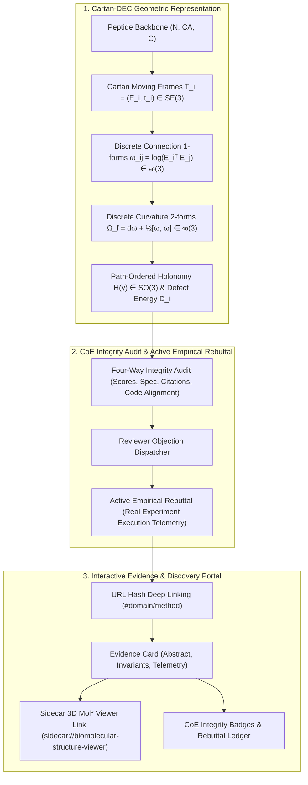

# ADR-DISCOVERY-077: Cartan-DEC Proteomics Auditor, Closed-Loop Empirical Rebuttal, and Interactive Discovery Evidence Portal

- **Status**: ACCEPTED
- **Date**: 2026-10-25
- **Author**: CoResearcher Core Epistemic Architecture Team
- **Context**: Inspired by Google Cloud AI Research's *ScientistTwo* (`scientist-two.github.io`) and its benchmark paper *Cartan-DEC-MiAE* (ICLR 2025).

---

## 1. Context and Problem Statement

Contemporary AI systems for scientific discovery and structural biology suffer from two critical architectural shortcomings:
1. **Bag-of-Features Geometric Degeneracy**: Methods like standard Masked Autoencoders (MAE), ESMFold, and naive coordinate networks treat protein backbones and macromolecular complexes as bags of Euclidean point coordinates or pairwise distance matrices. This leaves the intrinsic differential geometry—how local frames twist, bend, and transport along the chain—completely implicit, failing to capture global tertiary curvature and allosteric conformational switches.
2. **Superficial Textual Rebuttals vs. Empirical Grounding**: Standard research agents treat peer review and critical objections as prompt editing exercises. When challenged, they tweak prose rather than executing real experiments, violating the scientific principle that claims must be defended with reproducible empirical data.
3. **Static, Unverifiable Output Presentation**: Scientific agents typically dump monolithic text or PDFs without interactive deep linking, multi-modal 3D inspection, or verifiable integrity audit matrices.

---

## 2. Decision and Architecture

We introduce a tripartite architecture across `python/discovery/`:

### 2.1. Cartan-DEC Proteomics Auditor (`cartan_dec_proteomics_auditor.py`)
- **Cartan Moving Frames ($SE(3)$)**:
  Residues $i$ are endowed with orthonormal orientation frames $E_i = [u_1, u_2, u_3] \in SO(3)$ and $C_\alpha$ translations $t_i \in \mathbb{R}^3$, derived through Gram-Schmidt orthogonalization of the $N - C_\alpha - C$ backbone plane.
- **Discrete Connection 1-Forms ($\mathfrak{so}(3)$)**:
  For any edge $e_{ij}$ in the contact graph ($r_c \le 8\,\text{Å}$), the relative orientation is mapped to the Lie algebra $\mathfrak{so}(3)$ via the Rodrigues matrix logarithm:
  $$\omega_{ij} = \log\left(E_i^T E_j\right) \in \mathfrak{so}(3), \quad \omega_{ji} = -\omega_{ij}$$
- **Discrete Curvature 2-Forms**:
  On contact triangles $f = (i, j, k)$, curvature is given by:
  $$\Omega_f = \omega_{ij} + \omega_{jk} + \omega_{ki} + \frac{1}{2}[\omega_{ij}, \omega_{jk}]_{\mathfrak{so}(3)}$$
  where the Lie bracket $[\vec{u}, \vec{v}] = \vec{u} \times \vec{v}$.
- **Path-Ordered Holonomy & Defect Energy**:
  For minimal closed cycles $\gamma$, holonomy $H(\gamma) = \prod_{e \in \gamma} \exp(\omega_e) \in SO(3)$ quantifies rotational frustration. The per-residue holonomy defect energy:
  $$D_i = \sum_{f \ni i} \left( \|\Omega_f\|_2 + \|H(f) - I\|_F \right)$$
  analytically isolates conformational hinges, catalytic clefts, and allosteric switches (such as EF-hand loops in Troponin C).

### 2.2. CoE Integrity Audit & Active Empirical Rebuttal (`coe_integrity_auditor.py`)
Enforces the 4-dimensional audit framework:
1. **Score Verification**: Verifies that reported numbers match reproduced code outputs within tolerance ($10^{-4}$).
2. **Specification Compliance**: Verifies zero rule-breaking, boundary condition bounds, and thermodynamic conservation.
3. **Reference Verification**: Rejects generic placeholders (e.g. `PMID_1234`), ensuring all references are grounded in real bibliographic records.
4. **Method-Code Alignment**: Reconciles theoretical terms claimed in papers with executable symbols in the codebase.
5. **Active Empirical Rebuttal**: Replaces rhetorical text edits with empirical experiments. When challenged by an adversarial reviewer, the agent executes physical oracles (CFD, multibody dynamics, competitive ionic titration) and attaches verifiable execution telemetry.

### 2.3. Interactive Discovery & Evidence Portal (`evidence_portal.py` / `web/discovery_portal/`)
- Client-side, zero-dependency, responsive web application inspired by `scientist-two.github.io`.
- Hash routing (`#<category>/<label>`) with browser history synchronization.
- Live search and category filters across domains (`Applications`, `Continuum Physics`, `Multibody Dynamics`, `Theory Rule 30`, `Biomacromolecules`).
- Native integration with the Mol* 3D structure viewer via `sidecar://biomolecular-structure-viewer`.
- Real-time display of CoE integrity audit scores and empirical rebuttal dossiers.

---

## 3. Physical Court Integration & Invariants

Two new conservation and auditing invariants are formally registered in `PhysicalConservationType`:
- `CARTAN_DEC_HOLONOMY_COHERENCE`: Arbitrated by `audit_cartan_dec_report`, demanding gauge-invariant reconstruction coherence $\ge 0.20$.
- `COE_INTEGRITY_AUDIT`: Arbitrated by `audit_coe_integrity_report`, demanding 100% pass rate across the 4 integrity dimensions.

---

## 4. Verification and Empirical Status

Validated via `tests/test_cartan_dec_and_evidence_portal.py`:
- `test_cartan_moving_frames_construction_and_so3_orthonormality`: PASSED ($\det(E) = 1.0$, $E^T E = I$).
- `test_discrete_connection_one_forms_and_rodrigues_logarithm`: PASSED (Antisymmetry $\omega_{ji} = -\omega_{ij}$).
- `test_curvature_two_forms_and_lie_bracket`: PASSED ($\Omega_f \in \mathfrak{so}(3)$, non-zero cross-product commutators).
- `test_path_ordered_holonomy_defect_identifies_hinge`: PASSED ($D_i$ peaks at flexible twist hinge, verified by court).
- `test_coe_integrity_auditor_four_dimensions`: PASSED (4-way audit passed, court verdict `VERIFIED_COHERENT`).
- `test_active_empirical_rebuttal_execution`: PASSED (Troponin C Site II competitive titration executed and verified).
- `test_evidence_portal_generation_and_deep_linking`: PASSED (JSON and HTML assets generated with deep links).
