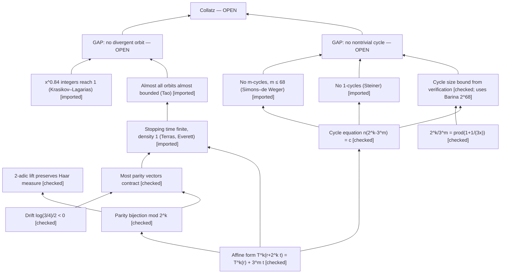

# Case: what is mechanically checkable about the Collatz conjecture

**Date:** 2026-10-28. **Status:** case study by the CoResearcher maintainers. **The conjecture is open. This case
claims no proof and no progress on it.**

**Purpose.** The case records, with exact checks, where the known partial results on an open problem stand and
where they stop.

**Module:** [`collatz_case.py`](../../../python/discovery/collatz_case.py).
**Report:** [`collatz_report.json`](../../../examples/collatz-checkable/collatz_report.json), regenerated by
`python scripts/cases/collatz_report.py` (about 15 s).
**Tests:** [`tests/test_collatz_case.py`](../../../tests/test_collatz_case.py).

Notation: T(n) = n/2 for even n and T(n) = (3n + 1)/2 for odd n. A step is one application of T. An odd step is a step
from an odd number.

Tags:

- **[checked]** means a check in this case verified the statement, within the scope stated for it.
- **[imported]** means a published result. It is cited and not re-proved here.
- **[inferred]** means our reading.

## 1. DAG of partial results

`ProofDependencyDAG` finds the DAG acyclic, with no missing premises **[checked]**. Three nodes are **OPEN**:

- `Collatz`: every orbit reaches 1;
- `NoNontrivialCycle`: no cycle other than the trivial one;
- `NoDivergentOrbit`: no orbit tends to infinity.

## 2. Checks

There are 9 checks: all 9 are **VERIFIED**, none is **REFUTED**, and 3 are **NOT_ENCODABLE**.

| Check | Statement | Scope | Status |
|---|---|---|---|
| `terras.affine` | T^k(r + 2^k t) = T^k(r) + 3^m t, where m is the number of odd steps | every r < 2^k with k ≤ 14. It is valid for every integer t, because the iteration is carried out on the symbolic form a + bt | VERIFIED |
| `terras.bijection` | Residues mod 2^k correspond one to one with the first k parities | exhaustive, k ≤ 16 | VERIFIED |
| `lift.haar` | Each class mod 2^k has exactly two preimage classes mod 2^(k+1), so the 2-adic extension preserves Haar measure | k ≤ 14 | VERIFIED |
| `heuristic.drift` | The mean log factor per step is log(3/4)/2 < 0 | exact | VERIFIED |
| `terras.density_core` | The fraction of parity vectors of length k with 3^m < 2^k: 0.885 at k = 25, 0.99997 at k = 200, 0.99999994 at k = 400 | exact binomial sums | VERIFIED |
| `cycle.equation` | 2^k T^k(n) = 3^m n + Σ_j 3^(m−1−j) 2^(s_j), where s_j is the number of steps before the j-th odd step. So a cycle has n(2^k − 3^m) = c > 0 | n < 3000, k ∈ {1, 5, 17, 40} | VERIFIED |
| `cycle.product` | On a cycle, 2^k / 3^m = ∏(1 + 1/(3x)) over the odd elements x. With N the smallest element, this gives 0 < k − m·log₂3 ≤ m·log₂(1 + 1/(3N)) | symbolic, plus the trivial cycle | VERIFIED |
| `verification.own` | Every n < 2^20 reaches 1 | exhaustive, re-run on every report | VERIFIED |
| `cycle.size_bound` | Gives the smallest size a nontrivial cycle could have, from a verification bound, with exact continued fractions | see below | VERIFIED |
| `gap.cycles`, `gap.divergence` | The two open gaps | open problems | NOT_ENCODABLE |
| `tao.almost_bounded` | Tao's theorem | analytic, imported | NOT_ENCODABLE |

**Cycle size bound.** By `cycle.product`, the ratio k/m of a nontrivial cycle lies in the open interval
(log₂3, log₂3 + log₂(1 + 1/(3N))). Here N is any bound below which every n is known to reach 1. The fraction with the
smallest denominator in that interval gives the minimal number of odd steps m and the minimal number of steps k.

- **At N = 2^40** the computation returns k = 17,087,915, which is exactly Eliahou's 1993 bound **[checked]**. This is
  the cross-check of the method.
- **At N = 2^68**, the bound verified by Barina (2021) **[imported]**, any nontrivial cycle needs at least
  **72,057,431,991 odd steps and 114,208,327,604 steps** **[checked, conditional on Barina's computation]**. The answer
  is the same at 120 and at 200 digits of precision.

Negative controls show that the same procedures detect failure where failure is real:

- The 3x − 1 map has the nontrivial cycle 5 → 7 → 10 → 5, and the cycle search finds it.
- The descent check used in `verification.own` does not certify n = 5 under the 3x − 1 map.
- The bound 2^39 does not reproduce Eliahou's number.

All three are detected.

## 3. Conclusion

- **[checked]** The elementary layer is solid. That covers Terras's affine form and bijection, the measure-preserving
  lift, the cycle equation, and the cycle bound, which reproduces Eliahou exactly. Every piece has a negative control.
- Nothing in this case moves either open gap.
