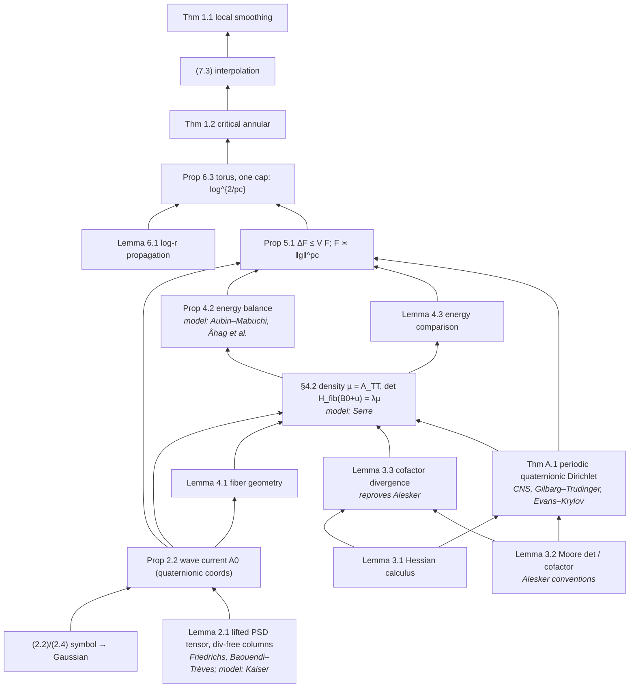

# Case: reasoning anatomy of "Local smoothing for the Euclidean wave equation"

**Date:** 2026-10-27. **Status:** case study by the CoResearcher maintainers. It is a companion to the statement-fidelity
case ([ADR-DISCOVERY-070](../../decisions/ADR-DISCOVERY-070-STATEMENT-FIDELITY-AUDIT.md),
[LOCAL_SMOOTHING_STATEMENT_FIDELITY.md](LOCAL_SMOOTHING_STATEMENT_FIDELITY.md)).
**Scope:** formal and mathematical soundness only. The case covers how the proof is put together, which identities it
depends on, and which moves can be reused. It does not judge credit, priority, novelty or any announcement.
**Module:** [`local_smoothing_anatomy.py`](../../../python/discovery/local_smoothing_anatomy.py) holds the DAG and the
checks. It reuses `ProofDependencyDAG` from `physical_theorem_court` and the ADR-070 coverage map. No new reusable
code was written, so this case has no ADR.
**Report:** [`anatomy_report.json`](../../../examples/local-smoothing-anatomy/anatomy_report.json) and
[`dag.mmd`](../../../examples/local-smoothing-anatomy/dag.mmd). Both are regenerated by
`python scripts/cases/local_smoothing_anatomy_report.py`, which takes about 70 s on a laptop.
**Tests:** [`tests/test_local_smoothing_anatomy.py`](../../../tests/test_local_smoothing_anatomy.py)

> **Reading rule.** Every claim below is tagged.
> - **[stated]** means a source text says it. The location is cited.
> - **[checked]** means a SymPy or z3 check in this case verified it, within the scope recorded for that check.
> - **[inferred]** means it is our reading of how the result was found. OpenAI released no reasoning summary for
>   family 079, so no claim about the model's actual search process is better than **[inferred]**.

## 1. Sources

Everything is pinned to commit `7ef5c0cc5ca4b0e072b7a050fca09ab24bc6fa3a` of
[github.com/openai/math](https://github.com/openai/math), the same commit as ADR-070. All of it was downloaded and read
as untrusted data. Nothing in it was executed.

| Role | Document | Pages | SHA-256 (prefix) |
|---|---|---|---|
| Target | Local smoothing for the Euclidean wave equation (Oct 25) | 59 | `9ca156c5` (equal to ADR-070) |
| Precursor | Critical local smoothing for the three-dimensional wave equation (Sep 24) | 165 | `79299093` |
| Precursor | Elliptic capacity propagation and Fourier restriction to the sphere (Sep 24) | 103 | `669efdbe` |
| Reasoning summary, family 087 | Symmetric and general Mahler conjectures | – | `933c27e3` |
| Reasoning summary, family 362 | Relativistic Vlasov–Maxwell | – | `fbb80877` |
| Process statements | `README.md`, `history.md` | – | `6cb7f0e3`, `ac688a38` |

What the process texts state:

- **[stated, README]** The results came from an unreleased internal model. On average each one used about three hours
  of ChatGPT Pro thinking compute. About 4,000 problems were posed in total. Some outputs build on earlier results
  from the same models.
- **[stated, history.md, Oct 26]** The proof of this paper uses an auxiliary PDE. It was released as direct model
  output.
- **[stated, README]** The table of reasoning summaries lists ten families. Family 079 is not one of them.

## 2. Lemma dependency DAG

The DAG has 39 internal results and 40 imported external results. The imported results are leaves: they are
recorded, not checked. `ProofDependencyDAG.verify_dag_acyclicity_and_completeness` finds **no cycle and no missing
premise** **[checked]**. Every external import is classified by how the paper uses it:

- *input*: a step of the proof relies on it.
- *model*: the paper names it as the template for a construction that it then carries out itself.
- *reproved*: the paper cites it and also gives its own proof.

Here is the core of the proof. Edges point from premise to consequence. The full graph, including Sections 8–12 and
Appendices B–E, is in `dag.mmd`.

Joined with the ADR-070 coverage map. Every one of its 25 rows joins to a node of the DAG (tested):

| Result | Premises | Imports | ADR-070 formal status |
|---|---|---|---|
| Thm 1.1 | (7.3) | Grafakos | Comparator target (range EQUIVALENT) |
| Thm 1.2 | Prop 6.3 | – | Lean statement outside Comparator, WEAKER (log power 2n + 5) |
| Cor 7.1 | (7.3) | Grafakos; Heo–Nazarov–Seeger (comparison) | outside Comparator, WEAKER |
| Prop 8.1 / 8.2 | – / App. C | BRRS, Stein / Fefferman, Fernández-Delgado–de la Salle | outside Comparator / not checked |
| Cor 9.1 | Lemma 9.2, Lemma 9.4, Thm 1.2 | Keich | Comparator (Kakeya, Kakeya maximal); prose (local extension) |
| Cor 9.3 | Lemma 9.2, Thm 1.2 | Tao ε-removal, Nicola | Comparator (sphere); outside Comparator (cone) |
| (9.7), §9.4 | Cor 9.1 | Tao, Gao–Liu–Xi, Nadjimzadah | outside Comparator |
| Thm 10.1 | Lemma 10.2, (10.3) | Beltran–Hickman–Sogge | Comparator (10.1); outside Comparator (maximal, a.e.) |
| Thm 11.1 | Lemmas 11.2, 11.3 | Seeger, Guo–Roos–Yung | Comparator |
| Cor 12.1 | Lemma 9.2, Thm 1.2, Cor 9.3 | Tao, Kim, Lee–Rogers–Seeger | prose only |
| Thm A.1, B.1, E.1 | see `dag.mmd` | see report | not checked / prose / not checked |

Three observations from the join:

1. **[checked]** The core, Sections 2–6 and Appendix A, has no row in the ADR-070 coverage map. ADR-070 searched only
   for top-line results, so this does not show that the lemmas lack Lean statements. It does show that nothing in this
   repository has looked at them. Soundness of the chain from Section 2 to Section 6 rests on the upstream Comparator
   kernel check of `euclidean_local_smoothing`, which ADR-070 did not re-run (`landrun`, Linux only).
2. **[checked]** Every application in Sections 9–12 uses the main proof only through Theorem 1.2 or Theorem 1.1, plus
   imported reductions. The quaternionic machinery does not reach the corollaries.
3. **[checked]** Remark 6.2 and Propositions 8.1–8.2 are not premises of Theorem 1.1. They are sharpness results.

## 3. Symbolic checks

The 13 encodable checks contain 129 assertions, and all 13 checks are **VERIFIED**. Six claims are
**NOT_ENCODABLE** at this depth. Five negative-control mutants each change one term, and all five are **REFUTED**
as expected. None of the checks is **REFUTED**. Each verdict covers only the scope written next to it.

| Check | Claim | Scope encoded | Status |
|---|---|---|---|
| `exponent.critical` | 2(1 + 1/d) = 2n/(n−1) = pc. Also pc = 1 + (n+1)/(n−1), s₊(pc) = 0, 2/pc = (n−1)/n, δ_pc = 1/(2n), B*(pc) = 1/2 + 1/pc | symbolic n | VERIFIED |
| `exponent.focusing` | The Prop 8.1 integrand u^{d−dp/2} has exponent −1 only at p = pc. Below pc the integral converges, and at pc it is a logarithm | symbolic d, p | VERIFIED |
| `exponent.scaling` | dp = 2n, q = n/(n−1) and Ap/q = 2A (Lemma 9.4). N^{n/p−d/2} = N⁰ (Lemma 9.2). 2An = 2(n−1) (9.6). The Kakeya radial power is 2/pc. The paraboloid power δ⁰ and the Schrödinger power λ⁰ (Cor 12.1). The scaling in (10.3). δ(p) = s₊(p) (Thm 10.1) | symbolic | VERIFIED |
| `exponent.interpolation` | (7.3): log powers d(1−2/p) and 2/p, and h power d/2 − n/p. Cor 9.3: θ = s/b and s ∈ (pc, b) (z3). Cor 7.1: the ℓ^r weight condition B > β + δ_p (z3) | symbolic + z3 (reals, n ≥ 2) | VERIFIED |
| `exponent.depth` | det(βeeᵀ + αI) = (β+α)α^{m−1}. Depth m^{1/d} times density m gives m^q = \|g\|^{pc}. h²s^{2d}(hs)^{−dq} = σ^{n−2} | m = 2..5 | VERIFIED |
| `lemma3.2.real` | (3.6) cofactor as derivative, (3.7) rank-one update, Euler C(A):A = m det A, (3.8) Schur determinant and completed square | **real symmetric only**, m = 2..4 | VERIFIED |
| `lemma3.3.real` | Columns of the Hessian cofactor are divergence free | **real one-slot Hessian**, generic u, m = 2, 3 | VERIFIED |
| `lemma4.3.model` | The rank-one segment formula det((1−θ)B + θD) = θᵐ det D + (1−θ)θ^{m−1}C(D):B, and the identity F = (m−1)/(m+1)·X0 + (λm(m+1))⁻¹∫∇uᵀC(Du)∇u, together with the bounds (4.14) | **real Monge–Ampère** on the unit ball of R², R³, with a constant rank-one B, polynomial u vanishing on the sphere and exact integrals. (4.14) was checked on one convex instance | VERIFIED |
| `eq2.2-2.4` | The null-frame phase (2.1) equals X·ξ − T\|ξ\|. The mode solves 2∂t∂s0 + Δ = 0. \|ξ\| = κ(1+\|v\|²/2)/√2. (2.2): −C(p), the kernel E(v) and the form \|w′ − vw0\|². The P-identity. The flux is null. (2.4): two real squares equal the complex modulus. Light-ray Gaussian 1 − ω·θ = \|ω−θ\|²/2. Normalization π^d | d = 1, 2, 3 | VERIFIED |
| `eq2.11-2.13` | The flux-map Jacobian 2R^{d+1} (so J = 4\|R\|^{2d+2}), M E(v) = 2R V^v, π(w)V^v = −(w−W)·(w−v)/2, and V_T^v | d = 1, 2, 3 | VERIFIED |
| `remark6.2` | p is harmonic with boundary values 1, 0. Δg = p. L is harmonic. ΔE = (cos T − 1)p ≤ 0. E(T,b) = 1 − cos T and E(T,3) = 0. g′ > 0. The bound 9 log(r/b)/(4D²) | symbolic, plus an exact grid of (b, r) for the last inequality | VERIFIED |
| `lemma6.1.radial` | x = log(s/b) turns the radial operator into s⁻²∂ₓ². The Volterra form of ψ. z(x−z)/x ≤ min(z, A−z) (z3). The κ² tail is 1/4. The sin(πT/3) integration by parts. The Prop 6.3 potential integral. The factor log 2/D² at r = 2b | algebraic steps only. The maximum principle and weak Harnack are not encoded. One numerical quadrature | VERIFIED |
| `thm11.1.l2` | 2α²∫u(1−u)^{2α−2} = α/(2α−1), and 1/2 + s₊(p) = n(1/2 − 1/p) | symbolic α | VERIFIED |
| `lemma2.1`, `prop2.2` | The lifted tensor is PSD with divergence-free columns. The quaternionic push-forward | – | NOT_ENCODABLE |
| `lemma3.2.quaternionic` | The Moore-determinant versions | – | NOT_ENCODABLE |
| `prop4.2`, `prop5.1`, `thmA.1` | The moving-domain Green identity, the kernel and Gaussian estimates, and the continuity method | – | NOT_ENCODABLE |

The negative controls, each expected **REFUTED** and each found **REFUTED**:

1. Lemma 4.3 with n/(n+1) in place of (n−1)/(n+1).
2. The Stein–Tomas exponent in place of pc in the focusing integral.
3. Remark 6.2 without the log term in g.
4. The two-term segment formula with a rank-two background.
5. The light-ray translation with its sign flipped.

What the checks do **not** establish: the quaternionic statements, the existence and regularity of the potential, and
any inequality that needs analysis (kernel bounds, the maximum principle, Harnack). The structural identities the
argument is built on hold. The places where the 59 pages could still fail are the six NOT_ENCODABLE items, which are
exactly the novel analytic steps.

## 4. Move catalog

Each move gives its trigger, the move itself, where it appears in the paper, how to reuse it, and the evidence tag.

### M1. Match the target exponent to an existing estimate's exponent

- **Trigger.** The target inequality sits at a critical exponent with a recognizable arithmetic form. Here
  pc/2 = n/(n−1) = 1 + 1/d.
- **Move.** Find a known estimate that produces exactly that power. Serre's compensated integrability bounds
  ∫(det A)^{1/(m−1)} for a positive divergence-free m × m tensor in m variables. The paper's version: rank-one curvature in an
  n-variable determinant gives (β + α)α^{n−1}, so depth ∝ µ^{1/(n−1)}, and (−u)µ ∝ µ^{n/(n−1)} = \|g\|^{pc}.
- **Where.** §1.4 (last paragraph of the energy sketch), §3 (opening), §4.2 after (4.8), Prop 5.1 interior bound.
- **Reuse.** Write the target exponent as 1 + 1/k. Search for estimates whose output power is a determinant root in
  k + 1 variables: compensated integrability, Monge–Ampère volume bounds, Brascamp–Lieb.
- **Evidence.** **[stated]** §3: the denominator of pc enters at this point. **[checked]** `exponent.depth`,
  `exponent.critical`. **[inferred]** That this exponent match was the *entry point* of the search is our reading.
  The paper is organized around it, and Serre is cited at the two places where the construction departs from him.

### M2. Repair a non-positive conservation law by lifting to imaginary/quaternionic auxiliary variables

- **Trigger.** The estimate in M1 needs a **positive** divergence-free tensor. The natural candidate, the wave stress
  tensor, is not positive for n ≥ 2. The paper states this, citing Serre (2019, §4.1).
- **Move.** Translate the solution in an imaginary spacetime direction along light rays. Each mode then picks up a
  Gaussian factor exp(−\|ξ\|\|ω − θ\|²/2), which filters it by direction, as a coherent state or Husimi window does. The
  displacement is taken to be the sum of two Friedrichs fluxes q = Σ wᵀCw/2 of real states. The Gram matrix of the
  continued wave is then a sum of four real squares (positive) whose real columns are divergence free in the combined
  variables (Lemma 2.1). Quaternionic coordinates are used to package the three real slots per spacetime index
  (Prop 2.2). Modes are summed *before* squaring, so the interference survives.
- **Where.** §1.4 (paragraph on related constructions), §2.1–2.3, Lemma 2.1, Prop 2.2. Kaiser's imaginary-displacement
  current for Klein–Gordon is cited as the closest precedent.
- **Reuse.** If your argument needs a positive conserved quantity and the physical one is indefinite: complexify the
  independent variables, take the imaginary displacement from the system's own flux (so it is a light ray), and use
  the Gram matrix of the continued solution as the tensor. Check two things: positivity (a sum of squares) and that the
  continued field is annihilated by the tube vector fields D_a = ∂_{w_a} + iV_a (divergence freeness).
- **Evidence.** **[stated]** §1.4 and §2. **[checked]** `eq2.2-2.4` (symbol, null flux, Gaussian, (2.4)) and
  `eq2.11-2.13`. **[not checked]** The divergence-free claim itself (`lemma2.1`, NOT_ENCODABLE).

### M3. Use the tensor's time component as the density of a Dirichlet Monge–Ampère problem, instead of its determinant

- **Trigger.** The lifted tensor is positive, but before averaging its determinant vanishes, because it is a sum of
  four squares (§1.4). So Serre's det-power cannot be applied directly.
- **Move.** Keep only µ = A_TT, regularized to be strictly positive. Prescribe it as the density of a quaternionic
  Monge–Ampère Dirichlet problem det H_fib(λ\|Φ\|² + u) = λµ, u = 0 on each spatial fiber. Add a rank-one background
  λ\|Φ\|². The background is invisible to the current (A : H(\|Φ\|²) = 0, because the current is tangent to Φ) but
  supplies one curvature direction to the determinant.
- **Where.** §4.1–4.2, (4.5)–(4.8), Theorem A.1.
- **Reuse.** When a positive tensor is degenerate, transfer its scalar density to a PDE whose solution has
  quantitative depth/density comparison. Pick the background in the kernel of the tensor, so it costs nothing in the
  conservation law and still sets the determinant's homogeneity.
- **Evidence.** **[stated]** §1.4, §4.2. **[checked]** The rank-one determinant (β+α)α^d (`exponent.depth`) and the
  real-model cofactor facts (`lemma3.2.real`, `lemma3.3.real`). **[not checked]** Theorem A.1.

### M4. Cancel the full determinant with an Aubin–Mabuchi segment functional

- **Trigger.** Differentiating X0 = ∫(−u)µ in the parameters (T, τ) produces the full determinant of
  H(B0 + u). That determinant has no sign.
- **Move.** Add E_z(u) = λ⁻¹∫u∫₀¹det D_{θu} dθ, the quaternionic counterpart of the Aubin–Mabuchi energy. Its
  Laplacian in z is +λ⁻¹∫det H(B0+u), which cancels that term exactly (Prop 4.2). The cofactor contributes no
  boundary term, because its normal–normal coefficient vanishes on the wall, and only the wave flux through the side
  remains. With a rank-one background the segment determinant has two terms, so F = E_z + X0 stays comparable to X0:
  (n−1)/(n+1)·X0 ≤ F ≤ n/(n+1)·X0 (Lemma 4.3).
- **Where.** §4.3, §4.4.
- **Reuse.** If a Green-formula computation leaves a nonlinear determinant term, look for the primitive of that
  determinant along the segment of potentials (the Mabuchi, Aubin I/J or BBGZ energy). The derivative of the primitive
  is the determinant, by definition. A low-rank background makes the primitive explicit.
- **Evidence.** **[stated]** §4.3 cites Mabuchi, Aubin and Åhag et al. **[checked]** `lemma4.3.model`, the full
  identity in a real model; the mutant with coefficient n/(n+1) is REFUTED. **[not checked]** Prop 4.2 itself.

### M5. Collapse everything to a scalar inequality ΔF ≤ VF in three variables; the planar harmonic log gives the loss

- **Trigger.** After M4 the only positive contribution is the boundary flux, and it is Gaussian-small,
  e^{−cs/h} (Prop 5.1).
- **Move.** Treat F(T, τ), with τ ∈ R², as a supersolution of −Δ + V with an integrable potential. The radial
  harmonic function in the τ-plane is affine in log\|τ\|. Each passage between the circles \|τ\| ≍ h and \|τ\| ≍ 1 costs
  one factor of log(1/h), and two passages give log². Taking the pc-th root gives log^{2/pc} (Lemma 6.1, Prop 6.3).
  Remark 6.2 shows the scalar argument cannot do better.
- **Where.** §6.
- **Reuse.** Once a functional satisfies a differential inequality in a few auxiliary variables, the shape of the
  loss is read off the auxiliary Green function. A 2D auxiliary plane gives logarithms, and higher dimensions give
  powers. Use Remark-6.2-type explicit supersolutions to certify that the scalar step is sharp, so that any
  improvement must come from upstream.
- **Evidence.** **[stated]** §1.4, §6. **[checked]** `lemma6.1.radial`, `remark6.2`; the mutant without the log term
  is REFUTED.

### M6. Off-the-shelf reductions for the corollaries

- **Trigger.** A sharp single-annulus estimate with an explicit logarithmic power, A = 2/pc.
- **Move.**
  - Local extension follows by modulation and stationary phase (Hörmander, Tao).
  - Global extension follows by Tao's ε-removal, interpolation, and Nicola's slicing to the cone.
  - Kakeya maximal follows from random signs on caps (Beckner–Carbery–Semmes–Soria, Bourgain). The power doubles
    to 2A.
  - Hausdorff dimension follows from Keich's grouping.
  - Nikodym follows by a projective map.
  - Bochner–Riesz follows from Beltran–Hickman–Sogge.
  - The square function follows by Seeger's method.
  - Paraboloid and Schrödinger follow by parabolic rescaling and Fresnel.

  Each reduction keeps track of the log power.
- **Where.** §§9–12.
- **Reuse.** Keep the loss as a parameter A through all reductions, as §9 does explicitly. One improvement upstream
  then propagates automatically.
- **Evidence.** **[stated]** §§9–12. **[checked]** `exponent.scaling`, `exponent.interpolation` (all powers equal 0
  where claimed). **[checked, DAG]** No corollary uses the quaternionic machinery.

### M7. Keep only one critical estimate and interpolate

- **Trigger.** A conjecture over a range of p whose difficulty is concentrated at one endpoint, pc.
- **Move.** Prove only the annular estimate at pc. Use the L² estimate (Plancherel) and the L^∞ estimate (cap kernel)
  for the other endpoints, then sum annuli (§7).
- **Reuse.** Standard, but worth stating as a search policy: aim the hard work at the single critical exponent.
- **Evidence.** **[stated]** §1.3 and §7. **[checked]** `exponent.interpolation`.

## 5. Contrast with the two precursors

| | 3D critical local smoothing (Sep 24, 165 pp) | Elliptic capacity propagation (Sep 24, 103 pp) | This paper (Oct 25, 59 pp) |
|---|---|---|---|
| Result | L³ local smoothing in R³, every ε > 0 | bounded-data restriction L^∞(S²) → L^p, p > 3 | all n ≥ 2. Also Kakeya, Bochner–Riesz, restriction interior |
| Core quantity | entropy of a finite phase-space record ("phase name") of wave packets | eccentricity-weighted ellipse capacity W(E) = L^{1+κ}w^{1−κ} of joint line laws | determinant energy F of a Monge–Ampère potential driven by a positive lifted current |
| Method family | wave packets, cylinder and round models, extremal reductions by contradiction, broad–narrow style splitting | probability of line parameters, hairbrush overlap, propagation exponents | conservation law, then PDE, then scalar supersolution |
| External quantitative inputs | Guth–Wang–Zhang wave envelopes; Ren–Wang planar Furstenberg **[stated]** | projection and Furstenberg tradition (Bourgain, Orponen, …) **[stated]** | Friedrichs, Kaiser (model), Serre (model), Alesker, CNS/Evans–Krylov, Aubin–Mabuchi (model) |
| Loss obtained | δ^{−ε} | p > 3 open range | explicit log^{2/pc} |

Cross-citation **[checked by text search]**:

- The 079 paper does not cite the 3D local-smoothing precursor anywhere.
- It cites the elliptic-capacity paper once, in §9.1, as an earlier proof of the S² range. It also cites the OpenAI 3D
  and 4D Kakeya preprints in the §9 discussion of earlier results.
- Neither precursor mentions Serre or compensated integrability.

**[inferred]** The October proof therefore does not grow out of the September wave-packet machinery. It looks like a
fresh route: harmonic analysis turned into a positivity and PDE problem, rather than a refinement of the 3D
entropy/envelope method. The README says some outputs build on earlier results. In this family the visible
dependence is only at the level of applications (Kakeya, restriction context), not of method.

## 6. Contrast with the released reasoning summaries (families 087 and 362)

The brief asked whether the "complexify, then positivity, then flux" signature appears in the released summaries.
What the summaries actually say:

- **Mahler, Part I (symmetric bound) [stated].** The summary says the attempt was led to planar boundary laws and
  *complexified slabs*. It then derives the lower bound from powers of an inverse conformal map, *positivity of the
  complex Hessian of a logarithmic potential*, Stokes' theorem and a *homogeneous flux calculation*. This is the same
  signature: complexify, take a positive (plurisubharmonic) object, then a Stokes/flux identity. Part III (the general
  body) records long runs of failed reductions. Sections 10–11 return to Nazarov's complex-analytic approach and to
  complex transport, without reaching the sharp constant.
- **Vlasov–Maxwell [stated].** The summary lists, among alternatives considered, a comparison of Serre's
  positive-stress construction for Vlasov–Poisson with the *indefinite* Maxwell stress. This is the same obstruction
  that M2 resolves for the wave equation. The route actually pursued was different: signed integration by parts along
  source labels, angular-event counting and a momentum bootstrap, ending in a conditional assertion. It used energy
  conservation and cone flux. **No complexification step appears in that summary.**

**[inferred]** The signature is fully visible in Mahler Part I. In Vlasov–Maxwell only half of it is visible: the
model recognizes "Serre needs positivity, the physical stress is indefinite", then turns away. In 079 the missing
step, an imaginary light-ray lift that makes the stress positive, is supplied. It is plausible that this is a recurring
move in the model's repertoire, but three documents do not establish frequency. Nor can we tell whether 079 was found
before or after the other two.

## 7. A replication protocol for the Fundación (inferred)

This is a procedure distilled from M1–M7. It is a hypothesis about what makes the approach work, to be tested on our
own problems. It is not a description of OpenAI's pipeline.

1. **Exponent first.** Write the critical exponent as 1 + 1/k and list known estimates whose output power has that
   form (M1). Let CoResearcher verify the arithmetic symbolically, as in `exponent.*`.
2. **Positivity audit.** For each candidate estimate, list its hypotheses that require positivity or sign. Check
   whether the natural object in your problem violates them (M2 trigger).
3. **Lift.** Try a complexified or coherent-state lift. Use the system's own flux as the imaginary direction, and test
   positivity and divergence freeness symbolically in the smallest dimension before generalizing.
4. **Degenerate tensor → density.** If the lifted object is degenerate, use one component as a density for an
   auxiliary elliptic PDE with a cost-free background (M3).
5. **Cancel the bad term with a primitive.** For every sign-indefinite term in a Green-formula computation, search
   for a functional whose variation is exactly that term (M4). Check the resulting identity in a finite-dimensional
   real model, as in `lemma4.3.model`.
6. **Read the loss off the auxiliary Green function** and certify sharpness of that step with an explicit
   supersolution (M5).
7. **Carry the loss as a parameter** through every reduction (M6). Keep the DAG and record each import's role.
8. **Budget.** The README reports about 3 h of model compute per posed problem and about 4,000 problems. Replication
   should plan for many independent attempts per problem and an audit pass like this one on each output. It should
   not plan for a single long run.

## 8. Limits

- No reasoning summary exists for family 079. Every statement about how the model searched is inference from the
  finished text and from two other families' summaries.
- The PDFs were read through `pdftotext`. Superscripts are sometimes lost; for example, the λ in (4.11) is λ⁻¹ by
  consistency with (4.8). Every formula that was checked was re-derived, not copied.
- The checks cover real models and exact algebra. Quaternionic Moore-determinant statements, Theorem A.1 and the
  analytic estimates of Prop 5.1 are not verified here. Neither is the Lean kernel check of Theorem 1.1 (see ADR-070).
- The DAG is at the granularity of numbered results and displayed equations. Inline uses of standard facts (Young,
  Hölder, Plancherel) are not nodes.
