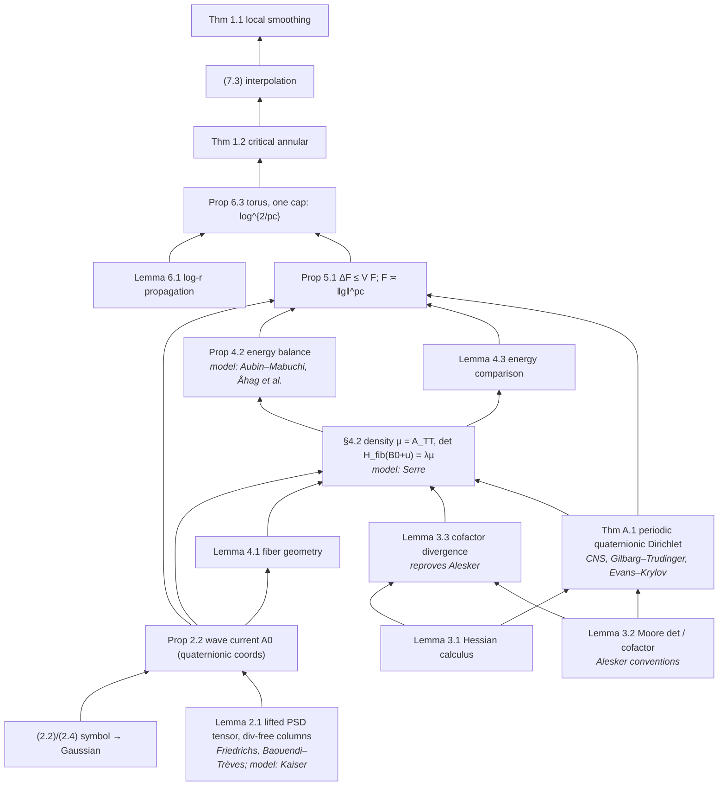

# Case: reasoning anatomy of "Local smoothing for the Euclidean wave equation"

**Date:** 2026-10-27. **Status:** case study by the CoResearcher maintainers. It is a companion to the statement-fidelity
case ([ADR-DISCOVERY-070](../../decisions/ADR-DISCOVERY-070-STATEMENT-FIDELITY-AUDIT.md),
[LOCAL_SMOOTHING_STATEMENT_FIDELITY.md](LOCAL_SMOOTHING_STATEMENT_FIDELITY.md)).
**Scope:** formal and mathematical soundness only. The case covers how the proof is put together and which identities it
depends on. It does not judge credit, priority, novelty or any announcement.
**Module:** [`local_smoothing_anatomy.py`](../../../python/discovery/local_smoothing_anatomy.py) holds the DAG and the
checks. It reuses `ProofDependencyDAG` from `physical_theorem_court` and the ADR-070 coverage map. No new reusable
code was written, so this case has no ADR.
**Report:** [`anatomy_report.json`](../../../examples/local-smoothing-anatomy/anatomy_report.json) and
[`dag.mmd`](../../../examples/local-smoothing-anatomy/dag.mmd). Both are regenerated by
`python scripts/cases/local_smoothing_anatomy_report.py`, which takes about 70 s on a laptop.
**Tests:** [`tests/test_local_smoothing_anatomy.py`](../../../tests/test_local_smoothing_anatomy.py)

> **Reading rule.** Every claim below is tagged.
> - **[stated]** means a source text says it. The location is cited.
> - **[checked]** means a SymPy or z3 check in this case verified it, within the scope recorded for that check.
> - **[inferred]** means it is our reading of how the result was found. OpenAI released no reasoning summary for
>   family 079, so no claim about the model's actual search process is better than **[inferred]**.

## 1. Sources

Everything is pinned to commit `7ef5c0cc5ca4b0e072b7a050fca09ab24bc6fa3a` of
[github.com/openai/math](https://github.com/openai/math), the same commit as ADR-070. All of it was downloaded and read
as untrusted data. Nothing in it was executed.

| Role | Document | Pages | SHA-256 (prefix) |
|---|---|---|---|
| Target | Local smoothing for the Euclidean wave equation (Oct 25) | 59 | `9ca156c5` (equal to ADR-070) |
| Precursor | Critical local smoothing for the three-dimensional wave equation (Sep 24) | 165 | `79299093` |
| Precursor | Elliptic capacity propagation and Fourier restriction to the sphere (Sep 24) | 103 | `669efdbe` |
| Reasoning summary, family 087 | Symmetric and general Mahler conjectures | – | `933c27e3` |
| Reasoning summary, family 362 | Relativistic Vlasov–Maxwell | – | `fbb80877` |
| Process statements | `README.md`, `history.md` | – | `6cb7f0e3`, `ac688a38` |

What the process texts state:

- **[stated, README]** The results came from an unreleased internal model. On average each one used about three hours
  of ChatGPT Pro thinking compute. About 4,000 problems were posed in total. Some outputs build on earlier results
  from the same models.
- **[stated, history.md, Oct 26]** The proof of this paper uses an auxiliary PDE. It was released as direct model
  output.
- **[stated, README]** The table of reasoning summaries lists ten families. Family 079 is not one of them.

## 2. Lemma dependency DAG

The DAG has 39 internal results and 40 imported external results. The imported results are leaves: they are
recorded, not checked. `ProofDependencyDAG.verify_dag_acyclicity_and_completeness` finds **no cycle and no missing
premise** **[checked]**. Every external import is classified by how the paper uses it:

- *input*: a step of the proof relies on it.
- *model*: the paper names it as the template for a construction that it then carries out itself.
- *reproved*: the paper cites it and also gives its own proof.

Here is the core of the proof. Edges point from premise to consequence. The full graph, including Sections 8–12 and
Appendices B–E, is in `dag.mmd`.

Joined with the ADR-070 coverage map. Every one of its 25 rows joins to a node of the DAG (tested):

| Result | Premises | Imports | ADR-070 formal status |
|---|---|---|---|
| Thm 1.1 | (7.3) | Grafakos | Comparator target (range EQUIVALENT) |
| Thm 1.2 | Prop 6.3 | – | Lean statement outside Comparator, WEAKER (log power 2n + 5) |
| Cor 7.1 | (7.3) | Grafakos; Heo–Nazarov–Seeger (comparison) | outside Comparator, WEAKER |
| Prop 8.1 / 8.2 | – / App. C | BRRS, Stein / Fefferman, Fernández-Delgado–de la Salle | outside Comparator / not checked |
| Cor 9.1 | Lemma 9.2, Lemma 9.4, Thm 1.2 | Keich | Comparator (Kakeya, Kakeya maximal); prose (local extension) |
| Cor 9.3 | Lemma 9.2, Thm 1.2 | Tao ε-removal, Nicola | Comparator (sphere); outside Comparator (cone) |
| (9.7), §9.4 | Cor 9.1 | Tao, Gao–Liu–Xi, Nadjimzadah | outside Comparator |
| Thm 10.1 | Lemma 10.2, (10.3) | Beltran–Hickman–Sogge | Comparator (10.1); outside Comparator (maximal, a.e.) |
| Thm 11.1 | Lemmas 11.2, 11.3 | Seeger, Guo–Roos–Yung | Comparator |
| Cor 12.1 | Lemma 9.2, Thm 1.2, Cor 9.3 | Tao, Kim, Lee–Rogers–Seeger | prose only |
| Thm A.1, B.1, E.1 | see `dag.mmd` | see report | not checked / prose / not checked |

Three observations from the join:

1. **[checked]** The core, Sections 2–6 and Appendix A, has no row in the ADR-070 coverage map. ADR-070 searched only
   for top-line results, so this does not show that the lemmas lack Lean statements. It does show that nothing in this
   repository has looked at them. Soundness of the chain from Section 2 to Section 6 rests on the upstream Comparator
   kernel check of `euclidean_local_smoothing`, which ADR-070 did not re-run (`landrun`, Linux only).
2. **[checked]** Every application in Sections 9–12 uses the main proof only through Theorem 1.2 or Theorem 1.1, plus
   imported reductions. The quaternionic machinery does not reach the corollaries.
3. **[checked]** Remark 6.2 and Propositions 8.1–8.2 are not premises of Theorem 1.1. They are sharpness results.

## 3. Symbolic checks

The 13 encodable checks contain 129 assertions, and all 13 checks are **VERIFIED**. Six claims are
**NOT_ENCODABLE** at this depth. Five negative-control mutants each change one term, and all five are **REFUTED**
as expected. None of the checks is **REFUTED**. Each verdict covers only the scope written next to it.

| Check | Claim | Scope encoded | Status |
|---|---|---|---|
| `exponent.critical` | 2(1 + 1/d) = 2n/(n−1) = pc. Also pc = 1 + (n+1)/(n−1), s₊(pc) = 0, 2/pc = (n−1)/n, δ_pc = 1/(2n), B*(pc) = 1/2 + 1/pc | symbolic n | VERIFIED |
| `exponent.focusing` | The Prop 8.1 integrand u^{d−dp/2} has exponent −1 only at p = pc. Below pc the integral converges, and at pc it is a logarithm | symbolic d, p | VERIFIED |
| `exponent.scaling` | dp = 2n, q = n/(n−1) and Ap/q = 2A (Lemma 9.4). N^{n/p−d/2} = N⁰ (Lemma 9.2). 2An = 2(n−1) (9.6). The Kakeya radial power is 2/pc. The paraboloid power δ⁰ and the Schrödinger power λ⁰ (Cor 12.1). The scaling in (10.3). δ(p) = s₊(p) (Thm 10.1) | symbolic | VERIFIED |
| `exponent.interpolation` | (7.3): log powers d(1−2/p) and 2/p, and h power d/2 − n/p. Cor 9.3: θ = s/b and s ∈ (pc, b) (z3). Cor 7.1: the ℓ^r weight condition B > β + δ_p (z3) | symbolic + z3 (reals, n ≥ 2) | VERIFIED |
| `exponent.depth` | det(βeeᵀ + αI) = (β+α)α^{m−1}. Depth m^{1/d} times density m gives m^q = \|g\|^{pc}. h²s^{2d}(hs)^{−dq} = σ^{n−2} | m = 2..5 | VERIFIED |
| `lemma3.2.real` | (3.6) cofactor as derivative, (3.7) rank-one update, Euler C(A):A = m det A, (3.8) Schur determinant and completed square | **real symmetric only**, m = 2..4 | VERIFIED |
| `lemma3.3.real` | Columns of the Hessian cofactor are divergence free | **real one-slot Hessian**, generic u, m = 2, 3 | VERIFIED |
| `lemma4.3.model` | The rank-one segment formula det((1−θ)B + θD) = θᵐ det D + (1−θ)θ^{m−1}C(D):B, and the identity F = (m−1)/(m+1)·X0 + (λm(m+1))⁻¹∫∇uᵀC(Du)∇u, together with the bounds (4.14) | **real Monge–Ampère** on the unit ball of R², R³, with a constant rank-one B, polynomial u vanishing on the sphere and exact integrals. (4.14) was checked on one convex instance | VERIFIED |
| `eq2.2-2.4` | The null-frame phase (2.1) equals X·ξ − T\|ξ\|. The mode solves 2∂t∂s0 + Δ = 0. \|ξ\| = κ(1+\|v\|²/2)/√2. (2.2): −C(p), the kernel E(v) and the form \|w′ − vw0\|². The P-identity. The flux is null. (2.4): two real squares equal the complex modulus. Light-ray Gaussian 1 − ω·θ = \|ω−θ\|²/2. Normalization π^d | d = 1, 2, 3 | VERIFIED |
| `eq2.11-2.13` | The flux-map Jacobian 2R^{d+1} (so J = 4\|R\|^{2d+2}), M E(v) = 2R V^v, π(w)V^v = −(w−W)·(w−v)/2, and V_T^v | d = 1, 2, 3 | VERIFIED |
| `remark6.2` | p is harmonic with boundary values 1, 0. Δg = p. L is harmonic. ΔE = (cos T − 1)p ≤ 0. E(T,b) = 1 − cos T and E(T,3) = 0. g′ > 0. The bound 9 log(r/b)/(4D²) | symbolic, plus an exact grid of (b, r) for the last inequality | VERIFIED |
| `lemma6.1.radial` | x = log(s/b) turns the radial operator into s⁻²∂ₓ². The Volterra form of ψ. z(x−z)/x ≤ min(z, A−z) (z3). The κ² tail is 1/4. The sin(πT/3) integration by parts. The Prop 6.3 potential integral. The factor log 2/D² at r = 2b | algebraic steps only. The maximum principle and weak Harnack are not encoded. One numerical quadrature | VERIFIED |
| `thm11.1.l2` | 2α²∫u(1−u)^{2α−2} = α/(2α−1), and 1/2 + s₊(p) = n(1/2 − 1/p) | symbolic α | VERIFIED |
| `lemma2.1`, `prop2.2` | The lifted tensor is PSD with divergence-free columns. The quaternionic push-forward | – | NOT_ENCODABLE |
| `lemma3.2.quaternionic` | The Moore-determinant versions | – | NOT_ENCODABLE |
| `prop4.2`, `prop5.1`, `thmA.1` | The moving-domain Green identity, the kernel and Gaussian estimates, and the continuity method | – | NOT_ENCODABLE |

The negative controls, each expected **REFUTED** and each found **REFUTED**:

1. Lemma 4.3 with n/(n+1) in place of (n−1)/(n+1).
2. The Stein–Tomas exponent in place of pc in the focusing integral.
3. Remark 6.2 without the log term in g.
4. The two-term segment formula with a rank-two background.
5. The light-ray translation with its sign flipped.

What the checks do **not** establish: the quaternionic statements, the existence and regularity of the potential, and
any inequality that needs analysis (kernel bounds, the maximum principle, Harnack). The structural identities the
argument is built on hold. The places where the 59 pages could still fail are the six NOT_ENCODABLE items, which are
exactly the novel analytic steps.

## 4. Contrast with the two precursors

| | 3D critical local smoothing (Sep 24, 165 pp) | Elliptic capacity propagation (Sep 24, 103 pp) | This paper (Oct 25, 59 pp) |
|---|---|---|---|
| Result | L³ local smoothing in R³, every ε > 0 | bounded-data restriction L^∞(S²) → L^p, p > 3 | all n ≥ 2. Also Kakeya, Bochner–Riesz, restriction interior |
| Core quantity | entropy of a finite phase-space record ("phase name") of wave packets | eccentricity-weighted ellipse capacity W(E) = L^{1+κ}w^{1−κ} of joint line laws | determinant energy F of a Monge–Ampère potential driven by a positive lifted current |
| Method family | wave packets, cylinder and round models, extremal reductions by contradiction, broad–narrow style splitting | probability of line parameters, hairbrush overlap, propagation exponents | conservation law, then PDE, then scalar supersolution |
| External quantitative inputs | Guth–Wang–Zhang wave envelopes; Ren–Wang planar Furstenberg **[stated]** | projection and Furstenberg tradition (Bourgain, Orponen, …) **[stated]** | Friedrichs, Kaiser (model), Serre (model), Alesker, CNS/Evans–Krylov, Aubin–Mabuchi (model) |
| Loss obtained | δ^{−ε} | p > 3 open range | explicit log^{2/pc} |

Cross-citation **[checked by text search]**:

- The 079 paper does not cite the 3D local-smoothing precursor anywhere.
- It cites the elliptic-capacity paper once, in §9.1, as an earlier proof of the S² range. It also cites the OpenAI 3D
  and 4D Kakeya preprints in the §9 discussion of earlier results.
- Neither precursor mentions Serre or compensated integrability.

**[inferred]** The October proof therefore does not grow out of the September wave-packet machinery. It looks like a
fresh route: harmonic analysis turned into a positivity and PDE problem, rather than a refinement of the 3D
entropy/envelope method. The README says some outputs build on earlier results. In this family the visible
dependence is only at the level of applications (Kakeya, restriction context), not of method.

## 5. Limits

- No reasoning summary exists for family 079. Every statement about how the model searched is inference from the
  finished text and from two other families' summaries.
- The PDFs were read through `pdftotext`. Superscripts are sometimes lost; for example, the λ in (4.11) is λ⁻¹ by
  consistency with (4.8). Every formula that was checked was re-derived, not copied.
- The checks cover real models and exact algebra. Quaternionic Moore-determinant statements, Theorem A.1 and the
  analytic estimates of Prop 5.1 are not verified here. Neither is the Lean kernel check of Theorem 1.1 (see ADR-070).
- The DAG is at the granularity of numbered results and displayed equations. Inline uses of standard facts (Young,
  Hölder, Plancherel) are not nodes.
